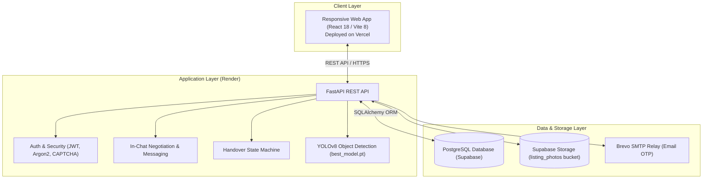

# 🤝 NeighborLend

Payment implementation: [test payment system and verification](docs/payment-system-verification.md).
Payments default to disabled. Local mock mode and Razorpay Test Mode are supported;
simulated deposit accounting is not actual escrow custody or lender payout. The
guide includes isolated setup, private evidence, administrator recovery and tests.

Current completion results: [payment hardening and standalone EP v3](docs/final-payment-ep-v3-report.md).
The opt-in [EP v3 engine](ep/docs/ep-v3.md) remains separate from application AI and payments.

A modern peer-to-peer neighborhood lending platform that allows neighbors to borrow, lend, and share everyday items (tools, electronics, sports gear, books, party supplies) instead of buying them new.

Built with a **React (Vite)** single-page frontend, a high-performance **FastAPI (Python)** backend, **PostgreSQL (Supabase)**, and an integrated **YOLOv8** computer-vision model for automatic item recognition.

---

## ⚡ Quickstart for Contributors

You can run the project in **two ways** depending on what you're working on:

### Mode A: Frontend-Only Development (Recommended 🚀)
If you are developing frontend features or designing pages, you **do not** need to install Python or set up a local database! You can connect your local frontend directly to the deployed team backend on Render.

1. **Clone the repository**:
   ```bash
   git clone https://github.com/<your-org>/NeighborLend.git
   cd NeighborLend
   ```

2. **Set up environment variables**:
   ```bash
   # Copy the example environment file
   cp .env.example .env      # On Linux/macOS
   # On Windows PowerShell:
   Copy-Item .env.example .env
   ```
   *(By default, `.env.example` already points `VITE_API_BASE_URL` to the live team backend: `https://neighborlend-6z0f.onrender.com/api`)*

3. **Install and run the frontend**:
   ```bash
   cd frontend
   npm install
   npm run dev
   ```
4. Open **`http://localhost:5173`** in your browser. You will see live listings and data!

---

### Mode B: Full-Stack Local Development (Frontend + Backend)
If you are working on backend endpoints, database models, or AI services:

#### 1. Start the Backend
Requirements: Python 3.10+ and pip.

```powershell
# From project root:
cd backend

# Create and activate a virtual environment
python -m venv venv
.\venv\Scripts\Activate.ps1    # On Windows
# source venv/bin/activate     # On Linux/macOS

# Install backend dependencies
pip install -r requirements.txt

# Start the FastAPI development server
python -m uvicorn app.main:app --reload --host 127.0.0.1 --port 8000
```
* Interactive API Documentation (Swagger UI): `http://127.0.0.1:8000/docs`
* Health Check: `http://127.0.0.1:8000/api/health`

#### 2. Start the Frontend
In a separate terminal window:
```powershell
cd frontend
npm install
npm run dev
```
Open `http://localhost:5173`. Local Vite will proxy API requests to your local backend.

---

## 🏛️ System Architecture



---

## 📂 Project Structure

```text
NeighborLend/
├── backend/
│   ├── ai_service/             # YOLOv8 model weights (best_model.pt) & damage prototype
│   ├── app/
│   │   ├── routers/            # FastAPI route handlers
│   │   │   ├── auth.py         # Login, registration, email OTP, Google OAuth
│   │   │   ├── listings.py     # Listing CRUD, distance search, pricing calculator
│   │   │   ├── borrow_requests.py # Borrow requests, 4-stage handover lifecycle
│   │   │   ├── chat.py         # In-chat negotiation, offers, counter-offers, messaging
│   │   │   ├── uploads.py      # Photo uploads with automatic YOLO object detection
│   │   │   └── notifications.py# User notification inbox
│   │   ├── models.py           # SQLAlchemy database models
│   │   ├── schemas/            # Pydantic validation schemas
│   │   ├── services/           # Business logic (pricing algorithm, storage, email)
│   │   ├── config.py           # Application settings and environment parsing
│   │   ├── database.py         # Database engine and schema migrations
│   │   └── main.py             # FastAPI entrypoint and CORS middleware
│   ├── tests/                  # Pytest test suite
│   ├── Dockerfile              # Production container build
│   └── requirements.txt        # Python package dependencies
│
├── frontend/
│   ├── public/                 # Static assets and icons
│   ├── src/
│   │   ├── api/client.js       # Centralized Axios instance with auth interceptors
│   │   ├── components/         # Reusable UI (Navbar, ListingCard)
│   │   ├── context/            # AuthContext (user state, login, register, token)
│   │   ├── design/             # Global design tokens and CSS themes
│   │   ├── pages/              # Routed views
│   │   │   ├── Browse.jsx      # Search items by category, keyword, and GPS distance
│   │   │   ├── ListingDetail.jsx # Item specs, owner profile, request button
│   │   │   ├── CreateListing.jsx # Multi-step form with AI photo detection
│   │   │   ├── CreateBorrowRequest.jsx # Post an open item request to neighbors
│   │   │   ├── Chat.jsx        # Direct messages + negotiation offer drawer
│   │   │   ├── BorrowRequestDetail.jsx # Live handover confirmation status
│   │   │   ├── Inbox.jsx       # Notification center
│   │   │   ├── Login.jsx       # Email/password & Google login
│   │   │   ├── Register.jsx    # Captcha-protected registration
│   │   │   └── VerifyEmail.jsx # 6-digit OTP email verification
│   │   ├── utils/              # Geolocation helper (detectUserLocation), photo URLs
│   │   ├── App.jsx             # React router configuration
│   │   └── main.jsx            # Application mount point
│   ├── vercel.json             # Vercel SPA routing and build configuration
│   └── package.json            # Node.js dependencies and scripts
│
├── docs/                       # Project documentation and feature guides
├── .env.example                # Template for environment settings
├── compose.yaml                # Docker Compose orchestration
└── render.yaml                 # Render Blueprint for backend deployment
```

---

## 🌟 Core Features & Workflows

### 1. Smart Authentication & Protection
* **CAPTCHA Challenge**: Lightweight math challenge on registration prevents automated bot signups.
* **Email OTP Verification**: Delivers a 6-digit one-time passcode via Brevo SMTP to verify user emails.
* **Google Sign-In**: One-click authentication using Google Identity Services.
* **JWT Tokens**: Secure bearer tokens stored on the client and attached via Axios request interceptors.

### 2. Listings & AI Auto-Tagging
* **Photo Upload**: Multi-file upload directly into public Supabase Storage buckets.
* **YOLO Object Detection**: Uploading an item photo runs inference against `ai_service/best_model.pt` to automatically identify the item (tools, bicycles, books, electronics) and pre-fill listing titles.
* **Proximity Filtering**: Computes real-time Haversine distance between borrower and item GPS coordinates.
* **Smart Rental Pricing Algorithm**: Calculates daily rent (4% of depreciated value) and refundable deposit (20%) based on purchase price and item age.

### 3. In-Chat Negotiations & Offers
* **Direct Conversations**: Continuous communication thread between borrower and lender.
* **Interactive Offers**: Send rental offers specifying daily rate, rental dates, and calculated totals.
* **Counter-Offer History**: Lenders and borrowers can counter back and forth; every iteration is preserved in a structured negotiation tree.
* **Conflict Checking**: Automatically blocks offers for dates that overlap with an existing accepted booking.

### 4. 4-Stage Handover & Dispute System
Once complete financial terms are accepted, verified test payment unlocks the handover sequence:
1. `pending` → `photos_uploaded`: Lender uploads private rental evidence.
2. `borrower_confirmed`: Borrower acknowledges receipt and records condition.
3. `lender_confirmed`: Lender acknowledges handover; active borrowing begins.
4. `issue_reported`: Platform review can resume confirmation, permit return, or authorize eligible recovery.
* **Return & Dispute**: Either party can mark the item as returned or file a dispute with detailed notes.

---

## 🚀 Deployment

### Deploying Frontend to Vercel
1. Fork or push your branch to GitHub.
2. Sign in to [Vercel](https://vercel.com) and click **"Add New..." $\rightarrow$ "Project"**.
3. Import your repository:
   * **Root Directory**: `frontend`
   * **Framework Preset**: Vite
   * **Environment Variables**:
     * `VITE_API_BASE_URL`: `https://neighborlend-6z0f.onrender.com/api` (or your backend URL)
     * `VITE_GOOGLE_CLIENT_ID`: Your Google OAuth Client ID
4. Click **Deploy**. Vercel will build and deploy your site on a global CDN.

### Backend on Render
The backend is configured to run on Render via `render.yaml`.
* Render service URL: `https://neighborlend-6z0f.onrender.com`
* When deploying a new frontend domain on Vercel, make sure your Vercel domain is added to `CORS_ORIGINS` in Render's environment settings.

---

## 🤝 Contribution Guidelines

1. **Branching**: Create a feature branch off `main`:
   ```bash
   git checkout -b feature/your-feature-name
   ```
2. **Commit Style**: Use conventional commit messages:
   * `feat: add star ratings to listing detail`
   * `fix: correct date calculation for same-day rentals`
   * `docs: update setup instructions`
3. **Run Checks**:
   * Frontend build test: `npm run build` inside `frontend/`
   * Backend test suite: `python -m pytest` inside `backend/`
4. **Open a Pull Request**: Push your branch and open a PR against `main` for review.
