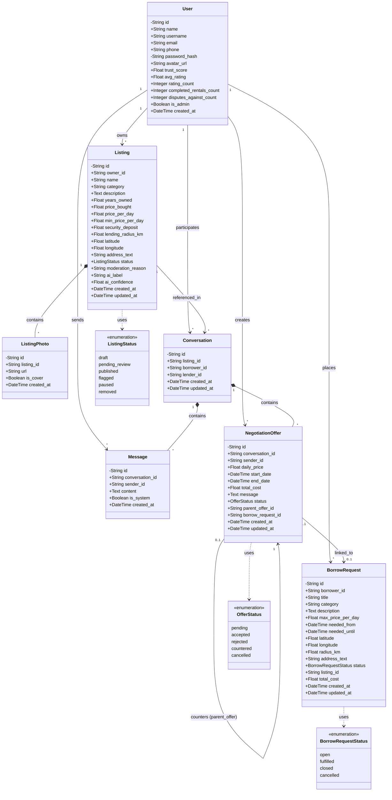

# NeighborLend - Architecture & System Documentation

NeighborLend is a community-driven peer-to-peer item sharing and rental platform built with FastAPI, React (Vite), SQLAlchemy, and an integrated YOLO object detection service for AI-assisted listing verification. It includes dynamic price suggestions, location-based distance calculations, and an in-app chat and rental negotiation engine.

---

## 1. Local Development Setup

### Clone the repository

```bash
git clone https://github.com/aviraj1576/NeighborLend.git
cd NeighborLend
```

### Prerequisites
- **Python 3.10+**
- **Node.js 18+ & npm**
- **Git**

Open two terminal windows (PowerShell or Bash) from the `NeighborLend/` project
directory. The existing Windows virtual environment is in the parent
`neighbourlend/venv/` directory.

---

### Backend Setup

From the repository root (`NeighborLend/`), activate the existing virtual
environment, change to `backend/` so Python can import the `app` package, and
start Uvicorn:
```powershell
..\venv\Scripts\Activate.ps1
Set-Location backend
python -m uvicorn app.main:app --reload --host 127.0.0.1 --port 8000
```

Alternatively, from the repository root, keep the current directory and add
the backend directory to Python's import path:
```powershell
$env:PYTHONPATH = (Join-Path (Get-Location) "backend")
..\venv\Scripts\python.exe -m uvicorn app.main:app --reload --host 127.0.0.1 --port 8000
```

Do not create a second virtual environment when using the existing
`neighbourlend/venv/` environment. If it is not activated, invoke the backend
from the `backend/` directory with its interpreter explicitly:
```powershell
..\venv\Scripts\python.exe -m uvicorn app.main:app --reload --host 127.0.0.1 --port 8000
```

From the `backend/` directory, the equivalent command with the already
activated environment is:
```powershell
python -m uvicorn app.main:app --reload --host 127.0.0.1 --port 8000
```

- **Interactive API Documentation (Swagger)**: `http://localhost:8000/docs`
- **ReDoc Documentation**: `http://localhost:8000/redoc`
- **Health Check Endpoint**: `http://localhost:8000/api/health`

#### Database & Seeding
The database tables are created automatically on startup.
- **SQLite (Default)**: Creates `neighborlend.db` locally.
- **Supabase / PostgreSQL**: Set `DATABASE_URL` in `.env` to connect to Supabase PostgreSQL.
- **Sample Data**: To seed mock accounts and listings, run:
  ```powershell
  cd backend
  python seed_data.py
  ```
  > [!WARNING]
  > Running `seed_data.py` drops and recreates all database tables. Do not run it in production.

Sample test accounts generated after seeding:
| Role | Email | Password |
|---|---|---|
| User (Alice) | `alice@example.com` | `password123` |
| User (Bob) | `bob@example.com` | `password123` |
| Administrator | `admin@example.com` | `admin123` |

---

### Frontend Setup

In a second terminal window:

```powershell
cd frontend
npm install
npm run dev
```

- **Web Application**: `http://localhost:5173`
- The frontend connects to the backend API specified by `VITE_API_BASE_URL` (defaults to `/api`). Vite proxies `/api` and `/uploads` to the local backend at `http://127.0.0.1:8000`; Docker uses Nginx to proxy these paths to the backend container.

---

## Running with Docker Compose

Docker Compose runs the Vite development server on port 5173 and FastAPI on
port 8000. The backend connects to PostgreSQL using the required `DATABASE_URL`
from the root `.env`; uploaded files use a persistent Docker volume when
Supabase Storage is not configured. The YOLO weights are included in the
backend image.

1. If this directory does not already have a `.env` file, create one from the
   example. Preserve any existing `.env` and update it instead:
   ```powershell
   if (!(Test-Path .env)) { Copy-Item .env.example .env }
   ```
   Set `JWT_SECRET` to a private, randomly generated value. Generate one with
   `python -c "import secrets; print(secrets.token_urlsafe(48))"` and paste the
   output into `.env`. Set `DATABASE_URL` to the PostgreSQL connection string
   used by your database. Never commit `.env` or put the Supabase service-role
   key in frontend/Vite variables.
2. From the `NeighborLend/` project directory, validate Compose, build both
   service images, and start the services:
   ```powershell
   docker compose config --quiet
   docker compose build backend frontend
   docker compose up -d backend frontend
   ```
3. Open `http://localhost:5173`. Check backend readiness at
   `http://localhost:8000/api/health`. Inspect service status and logs with:
   ```powershell
   docker compose ps
   docker compose logs --tail=100 backend frontend
   ```
4. Stop without removing containers or volumes, then start again with:
   ```powershell
   docker compose stop
   docker compose start
   ```

The Vite server proxies `/api` and `/uploads` to the backend service over the
Compose network. Browser API requests use the same-origin `/api` path; Supabase
Storage URLs are returned directly to the browser. Supabase credentials are
loaded only into the backend container. To use Supabase Storage, set both
`SUPABASE_URL` and `SUPABASE_SERVICE_ROLE_KEY` in `.env`; otherwise uploads go
to the persistent local uploads volume. The frontend Dockerfile also has a
`production` target for an Nginx build.

---

## 2. Configuration & Environment Variables

Copy or edit the `.env` file in the project root:

```env
# Database connection string (SQLite or Supabase PostgreSQL)
DATABASE_URL=sqlite:///./neighborlend.db

# Authentication
JWT_SECRET=your-secure-random-secret-key
JWT_ALGORITHM=HS256
JWT_EXPIRE_MINUTES=10080

# File Storage & URLs
UPLOAD_DIR=./uploads
PUBLIC_BASE_URL=http://localhost:8000

# AI Verification
AI_MODEL_PATH=./ai_service/best_model/best.pt
AI_CONFIDENCE_THRESHOLD=0.45

# Mock Payments & CORS
MOCK_PAYMENTS=true
CORS_ORIGINS=http://localhost:5173,http://localhost:5174,http://127.0.0.1:5173,http://127.0.0.1:5174
ADMIN_EMAILS=admin@neighborlend.com

# Optional: Supabase Storage Integration
SUPABASE_URL=
SUPABASE_SERVICE_ROLE_KEY=

# Google Identity Services Web client ID (use the same ID in both variables)
GOOGLE_CLIENT_ID=
VITE_GOOGLE_CLIENT_ID=

# SMTP provider for email verification OTPs
SMTP_HOST=
SMTP_PORT=587
SMTP_USERNAME=
SMTP_PASSWORD=
SMTP_FROM_EMAIL=
SMTP_USE_TLS=true
```

> [!NOTE]
> File uploads automatically resolve to the backend uploads directory regardless of the current working directory from which uvicorn is launched, preventing static file 404 errors. If Supabase credentials are configured, uploads are stored directly in Supabase Storage.

### Authentication and Inbox setup

Email/password registration keeps the existing CAPTCHA and sends a 6-digit,
10-minute verification code through the configured SMTP server. Configure
`SMTP_HOST`, `SMTP_PORT`, `SMTP_USERNAME`, `SMTP_PASSWORD`, and
`SMTP_FROM_EMAIL` in `.env`; `SMTP_USE_TLS=true` enables STARTTLS (port 465 uses
implicit TLS). The code is never returned by the API. Users must verify their
email before password login, and resend requests are rate-limited to one per
minute. Existing accounts are retained as verified by the additive startup
migration.

For Google Sign-In, create a **Web application** OAuth client in Google Cloud
Console, add each frontend origin (for example `http://localhost:5173`) to its
authorized JavaScript origins, and set its client ID in both `GOOGLE_CLIENT_ID`
and `VITE_GOOGLE_CLIENT_ID`. The frontend sends Google's ID token to FastAPI,
which validates the signature, audience, issuer, and verified email before
issuing the existing `nl_token` JWT. No Google client secret is needed for this
ID-token flow. For local development, put both values in the project-root
`.env`; Vite is configured to read that file when started from `frontend/`.
Restart both the frontend and backend after setting the values. Until a client
ID is configured, the login page displays the Google option and explains that
OAuth setup is required, but Google authentication cannot complete.

The authenticated inbox is available at `/inbox`; notifications are generated
for matching new borrowing requests, conversation/offer activity, approvals,
rejections, rental returns, and disputes. The API exposes
`GET /api/notifications`, `GET /api/notifications/unread-count`,
`PATCH /api/notifications/{id}/read`, and
`PATCH /api/notifications/read-all`. Return and dispute reports are available
to either participant on confirmed rental requests. Inbox and verification
tables are created automatically; the existing `users` and `borrow_requests`
tables receive additive columns without dropping data.

---

## 3. Project Architecture

The application follows a decoupled full-stack architecture with modular backend services and reactive frontend components.

```
NeighborLend/
├── backend/
│   ├── ai_service/             # YOLO object detection models and weights
│   ├── app/
│   │   ├── models.py           # SQLAlchemy database models
│   │   ├── database.py         # DB engine & session setup
│   │   ├── config.py           # Settings management via Pydantic
│   │   ├── main.py             # FastAPI entrypoint & static mounts
│   │   ├── routers/
│   │   │   ├── auth.py         # Login, registration, token refresh
│   │   │   ├── listings.py     # Listing CRUD, distance filtering, pricing
│   │   │   ├── borrow_requests.py # Borrow requests lifecycle
│   │   │   ├── chat.py         # Chat messaging & rental negotiations
│   │   │   ├── ai.py           # Item categorization & verification
│   │   │   └── uploads.py      # Image uploads & ML object detection
│   │   ├── schemas/            # Pydantic schemas (request/response validation)
│   │   └── services/           # Core domain logic
│   │       ├── auth.py         # Password hashing & JWT helpers
│   │       ├── ml_service.py   # YOLO vision model inference
│   │       ├── negotiation.py  # Offer validation & counter-offer workflows
│   │       ├── pricing.py      # Algorithmic price suggestion
│   │       └── storage_service.py # Local / Supabase storage handling
│   ├── uploads/                # Local uploaded listing images
│   └── seed_data.py            # Development database seed script
│
├── frontend/
│   ├── src/
│   │   ├── api/                # Axios instance with auth interceptors
│   │   ├── components/         # Reusable UI widgets (Navbar, ListingCard)
│   │   ├── context/            # Global state (AuthContext)
│   │   ├── design/             # Theme tokens and global stylesheets
│   │   ├── utils/              # Shared helpers (location detection)
│   │   ├── pages/
│   │   │   ├── Browse.jsx      # Geo-search and category filter
│   │   │   ├── Chat.jsx        # Real-time negotiation & message thread
│   │   │   ├── CreateListing.jsx # AI-assisted photo upload & listing form
│   │   │   ├── CreateBorrowRequest.jsx # Custom request creation
│   │   │   ├── ListingDetail.jsx # Item specs, lender info, offer trigger
│   │   │   ├── MyListings.jsx  # Inventory management
│   │   │   ├── Login.jsx & Register.jsx # Authentication views
│   │   │   └── Landing.jsx     # Landing page
│   └── package.json
└── README.md
```

For a route-by-route guide to the frontend, reusable components, shared state, and styles—including how the listing category badge gets its value—see [the frontend component and category badge explanation](./docs/category-badge-explanation.md).

---

## 4. UML Class Diagram

The following UML diagram models the primary entities and relationships across the platform, including the rental negotiation and messaging system.



### Explanation of Core Entities

1. **User**: Represents a member of the community. Maintains trust metrics (`trust_score`, `avg_rating`, `disputes_against_count`) and owns listings, borrow requests, and conversation threads.
2. **Listing & ListingPhoto**: Represents an item available for community lending. It links to multiple photos (composition relationship). When an image is uploaded, YOLO object detection validates category and tags.
3. **BorrowRequest**: Allows community members to broadcast requests for items not currently listed, matching nearby lenders.
4. **Conversation**: Manages real-time threads anchored to a specific item between a borrower and a lender.
5. **NegotiationOffer**: Represents rental agreements under active negotiation. Tracks rental dates, negotiated daily rates, computed total cost, and negotiation state (`pending`, `accepted`, `rejected`, `countered`, `cancelled`).
6. **Message**: Contextual discussion and automated system notifications within a conversation.

---

## 5. Key System Capabilities

- **AI-Powered Item Verification**: Automatically tags and verifies uploaded images using a custom-trained YOLO model (`ultralytics`), suggesting labels and confidence scores before publishing.
- **Dynamic Price Recommendation**: Suggests realistic daily rental prices based on the item category, original purchase price, and years owned.
- **Geospatial Proximity Search**: Uses the Haversine formula to filter and sort available listings by distance from the borrower's coordinates.
- **In-App Negotiation & Counter-Offers**: Structured negotiation engine allowing borrowers and lenders to propose, counter, accept, or decline daily rates and rental date windows directly within the chat interface.
- **Resilient Multi-Target Storage**: Supports local filesystem storage with working-directory-independent paths and seamless failover/switch to cloud-based Supabase Storage buckets.
