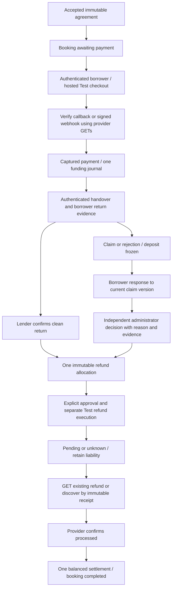

# Current payment architecture — 11 November 2026

NeighborLend implements Razorpay **Test Mode** payments and internal simulated deposit accounting. It does not implement regulated escrow, live payment capture dispatch, lender payouts or marketplace transfers. The [final release audit](payment-final-release-audit-20261111.md) records what was actually verified, including failures and unverified deployment requirements. EP v3 is not integrated.

## Components and authority

| Component | Responsibility |
| --- | --- |
| `app/services/negotiation.py`, accepted offer and `RentalBooking` | Agreed participant/listing/date/price snapshots; integer paise and INR are authoritative |
| `app/services/payments.py` | Booking locks, capture verification, handover gates, return/dispute authorization, immutable refund allocations, attempts and settlement transitions |
| `app/services/razorpay_service.py` | Explicit disabled/mock/Test provider selection, Test-key validation, fixed official HTTPS origin, operation allowlist and HMAC |
| `app/services/escrow_service.py` | Positive, balanced journal lines and exact reference replay checks; simulated lender receivables |
| `app/payment_models.py`, `app/services/payment_migrations.py` | Financial tables, unique references and provider IDs; ORM guards; separately installed database triggers and versioned schema |
| `app/routers/payments.py`, `app/routers/disputes.py` | JWT and object-level authorization, no-store financial views, role-specific actions, signed webhook ingestion and independent administrator review |
| `app/webhook_ingress.py` | Separate webhook-only ingress; fixed loopback upstream, exact POST path, raw-byte HMAC, bounded bodies/timeouts, stripped caller headers |
| `EscrowStatusCard`, `PaymentModal`, `RefundPanel`, `DisputeResolutionModal` | Backend-derived permissions and Test labels; explicit refund dispatch approval; separate status refresh, reconciliation and human review |

Only the borrower creates/verifies checkout, and client-supplied financial amounts are rejected. Hosted callback HMAC alone is insufficient: authoritative provider order/payment identity, captured status, exact integer amount and INR must agree. Unique operation references and serialized booking transitions post funding once. Historical unpaid rentals remain locked.

The lender confirms an undisputed clean return or records a reasoned claim. A borrower response is versioned evidence of agreement/disagreement and does not authorize a deduction. Disputed settlement requires an authenticated administrator who is neither participant, with recorded return evidence, a reason and an amount bounded by the deposit. Scenario B's decision explicitly labels its ₹600 assessment as simulated; it is not a finding that physical damage was independently established. AI references confer no financial authority.

## Refund recovery and settlement

Return confirmation and administrator review create durable allocations, without sending a gateway refund. `/api/payments/refunds/execute` requires literal `gateway_refund_approved: true` for Test dispatch. `/api/payments/refunds/reconcile` performs provider GETs only; it is still an application mutation endpoint because it records observations/attempts and can post a confirmed settlement. It must not be called during a read-only audit. **Refresh payment status** uses a protected booking GET and does not reconcile.

The intent owns an immutable booking, refund amount, deduction, kind and authorizer. A dispatching attempt has a 30-second recovery lease. Unknown outcomes retain the original idempotency key/payload; known refunds are fetched by ID, and unknown IDs can be discovered by receipt. Late responses are fenced by active attempt identity. Only an administrator can authorize replacement after authoritative terminal failure. These safeguards and the `X-Refund-Idempotency` header align with [Razorpay's idempotent refund contract](https://raw.githubusercontent.com/razorpay/markdown-docs/master/api/refunds/normal-refunds-idempotent.md).

Positive refunds settle only after provider `processed`, matching payment, amount, currency, refund ID and receipt when returned. `pending`, `failed` and `unknown` keep the liability reserved. A zero-refund allocation needs no gateway request. A historical pending attempt is retained even after a later observation confirms processing. Each booking has at most one authorized allocation and one settlement reference; simulated lender allocation never invokes a payout API.

| Event | Debit paise | Credit paise |
| --- | --- | --- |
| A/B funding | Gateway clearing 250000 | Rental fee clearing 50000; deposit held 200000 |
| B freeze | Deposit held 200000 | Deposit frozen 200000 |
| A settlement | Deposit held 200000; rental clearing 50000 | Gateway clearing 200000; simulated lender receivable 50000 |
| B settlement | Deposit frozen 200000; rental clearing 50000 | Gateway clearing 140000; simulated lender receivable 110000 |

The original ₹1 booking remains funded with a 100-paise balanced funding journal, no refund and no settlement. A and B are completed and settled. A refunded the entire deposit, rather than the entire payment: both payment entities correctly say `refund_status=partial` while their refund entities say `processed`.

## Persistence and deployment boundaries

SQLite financial transitions use `BEGIN IMMEDIATE`; the PostgreSQL path uses booking row locks. Provider I/O occurs after committing durable intent and outside the financial mutation transaction. Production behavior under PostgreSQL has **not** been exercised on a dedicated service; the three optional PostgreSQL tests remain skipped.

**Schema creation is not payment migration.** `Base.metadata.create_all()` installs tables and declared constraints; `migrate_payments()` separately installs the append-only, terminal-state, decision and journal-balance triggers and schema version. Importing the application is inert and `AUTO_MIGRATE=false` is intentional. In the current historical sandbox, all 44 scenario/provider/accounting checks passed, but read-only inspection found **no payment schema-version table and no SQLite triggers**. Its launcher used table creation alone. ORM/application checks and unique/check constraints remain, but database-level trigger protection must not be claimed for this database. This audit did not migrate it. Prepare and validate a fully migrated new isolated database for future mutation demonstrations; preserve the historical database.

The active API binds `127.0.0.1:8001`, frontend `127.0.0.1:5175`, and ingress `127.0.0.1:8010`. The existing tunnel targets only ingress. Private route GETs are denied locally through ingress and through the public origin. Host and forwarded-header rejection protects the private local API. Public/production configuration requires a strong private JWT signing secret; the active local signing secret fails that stronger policy and must not be reused publicly. No credential was rotated in this audit.

The ingress and backend validate the original webhook bytes with HMAC-SHA256, minimize persisted payloads, and deduplicate by event ID/body hash. Provider GETs decide the financial outcome. [Razorpay documents raw-body signature validation and duplicate-event handling](https://razorpay.com/docs/webhooks/validate-test/). Correlated local receipts exist for all three payments and both refunds. Because the same webhook secret is locally available and independent Dashboard delivery records were not supplied, stored receipts do not independently prove external delivery provenance or Dashboard-secret matching.

The subsystem is suitable for a supervised, local academic demonstration of the completed scenarios and isolated regressions, with the documented limitations. It is not production-ready: schema installation, signing-key provisioning, dependency security, PostgreSQL verification, independent webhook provenance and deployment operations remain release gates. See the final audit for exact results and preservation evidence.
