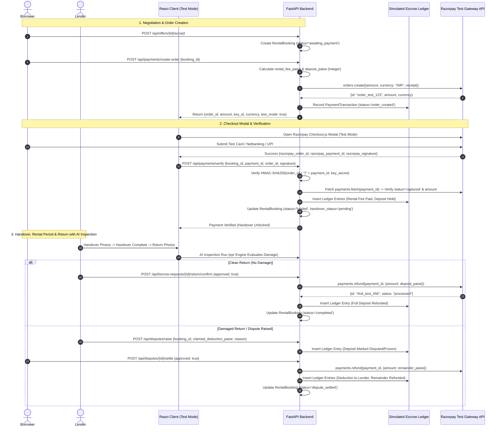
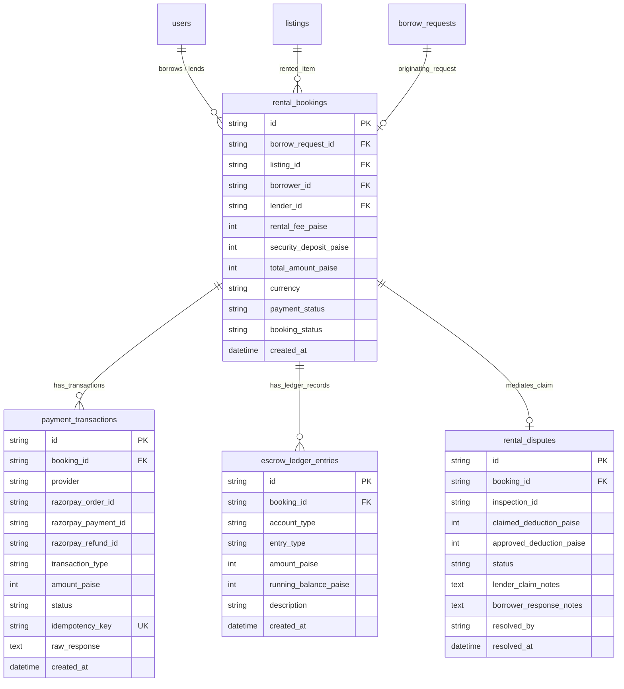
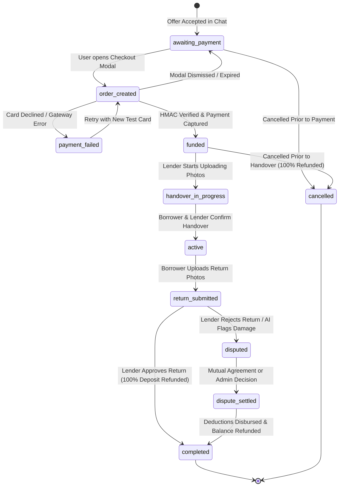
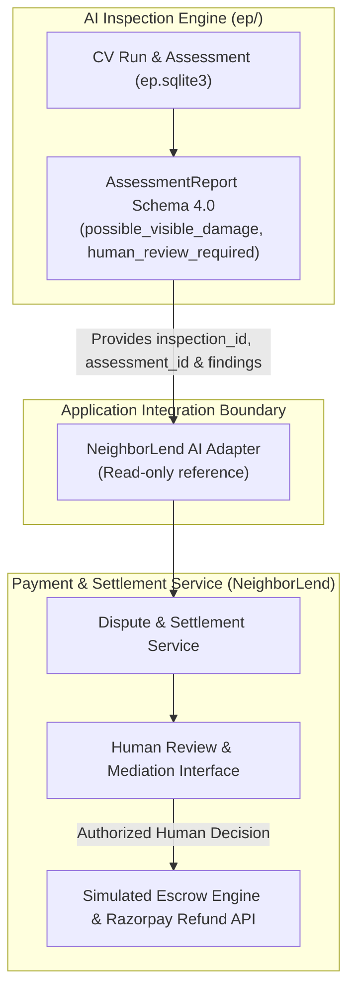
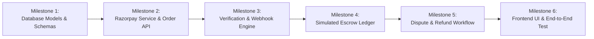

# NeighborLend — Payment & Simulated Escrow Architecture Audit

Current implemented architecture: [payment architecture](payment-architecture.md).
Current verified results and release limitations: [final release audit, 11 November 2026](payment-final-release-audit-20261111.md).

> Historical pre-implementation architecture specification. Its descriptions of
> missing payment features are not a current-code audit. See
> [the current implementation and verification guide](payment-system-verification.md).
**Razorpay Test Mode & Simulated Escrow Architecture Specification**

- **Document Version:** 1.0.0
- **Environment Target:** Razorpay Test Mode Only (`rzp_test_*`)
- **Repository Root:** `D:\neighborlend_project\NeighborLend\`
- **Status:** Analysis & Architecture Specification (Implementation Ready)
- **Classification:** Strictly Analysis-Only — No active production credentials, live transactions, or code modifications.

---

## 1. Executive Summary

NeighborLend is a peer-to-peer neighborhood sharing platform built with a **FastAPI (Python 3.11/3.14)** backend, **SQLAlchemy 2.0 ORM**, and a **React 18 (Vite 8)** single-page frontend.

### Existing Payment Readiness & Critical Gaps
1. **Zero Payment Gateway Integration:**
   - The repository contains **no active payment integration**.
   - A configuration variable `MOCK_PAYMENTS: bool = True` exists in `backend/app/config.py`, `compose.yaml`, and `.env.example`, but code inspection proves it is **dead configuration** never referenced in any route, model, or service.
   - Neither `razorpay` nor any other payment SDK is present in `backend/requirements.txt`.
   - The frontend (`package.json`) lacks Razorpay Checkout script loaders or SDK wrappers.
2. **Missing Escrow & Financial Ledger:**
   - The platform calculates a suggested rental rate (4% of depreciated asset value) and refundable deposit (20%) in `backend/app/services/pricing.py`.
   - However, when a rental offer is accepted in `backend/app/routers/chat.py`, the system creates a `BorrowRequest` record and immediately transitions `handover_status` to `pending`.
   - **No payment is collected, no pre-authorization is placed, and no deposit collateral is held.**
   - Physical handover currently occurs without financial commitment.
3. **Dispute Resolution Dead-End:**
   - If a lender rejects a returned item in `backend/app/routers/borrow_requests.py:631`, the system merely sets `disputed_at = now()` and stores a raw string `dispute_description`.
   - No financial claim entity, evidence linkage, or deposit deduction/refund mechanism exists.
4. **AI Inspection Integration Readiness:**
   - The AI inspection engine in `ep/` has completed Phase 5 verification and provides a rigorous contract (`ep/docs/phase-5-integration-contract.md`).
   - The contract mandates: `payment_action=none` and `physical_identity_verified=false` are invariant in the AI engine. Human review is mandatory.
   - The payment and dispute service must own all financial settlement decisions.

### Proposed Architecture Solution
We design a **Razorpay Test Mode** payment pipeline coupled with an **Internal Double-Entry Simulated Escrow Ledger**. 
- Razorpay Test Mode executes test card/UPI payment captures and programmatic refunds.
- The platform maintains an auditable internal ledger tracking exact minor-unit (integer paise) allocations: rental fee earned, deposit held in trust, deductions captured, and deposit refunds disbursed.
- Clear `[TEST MODE - SIMULATED ESCROW]` banners and receipts are displayed across the frontend.

---

## 2. Actual Repository Architecture

### Technology Stack Mapping
- **Backend Framework:** FastAPI 0.115.0 with Uvicorn 0.30.0.
- **ORM & Database:** SQLAlchemy 2.0.35 with session injection via `app.database.get_db`. Supports SQLite (local dev) and PostgreSQL (production).
- **Authentication:** OAuth2 Bearer JWT (HMAC-SHA256 via `python-jose`) verified in `app.services.auth.get_current_user`.
- **Frontend Framework:** React 18.3.1, React Router DOM 7.18.4, Axios 1.7.7.
- **Styling:** Modular CSS tokens (`theme.css`, `global.css`, and scoped page styles).

### Key Repository Components Relevant to Payments & Rentals

| File Path | Role & Architectural Purpose | Current Implementation Status |
|---|---|---|
| `backend/app/main.py` | FastAPI entrypoint, router mounting, CORS, lifecycle warmup. | **EXISTS** (Requires mounting `/api/payments` and `/api/disputes`) |
| `backend/app/config.py` | Pydantic BaseSettings loading environment variables. | **EXISTS** (Contains unused `mock_payments`; needs Razorpay keys) |
| `backend/app/models.py` | Declarative database models (10 tables). | **EXISTS** (Lacks payment, booking, dispute, and ledger entities) |
| `backend/app/database.py` | Database engine, session maker, additive `migrate_schema()`. | **EXISTS** (Must incorporate new billing/ledger tables) |
| `backend/app/routers/chat.py` | Negotiation messaging and offer acceptance (`accept_offer`). | **EXISTS** (Directly spawns handover without payment barrier) |
| `backend/app/routers/borrow_requests.py` | Handover state machine, photo uploads, return, and rating. | **EXISTS** (Handles handover and return without payment checks) |
| `backend/app/services/pricing.py` | Rule-based rental and deposit pricing formula. | **EXISTS** (Calculates 4% daily rent and 20% deposit in Float) |
| `backend/app/services/negotiation.py` | Duration calculation and booking overlap conflict checking. | **EXISTS** (Calculates rental days and checks date overlap) |
| `ep/docs/phase-5-integration-contract.md` | Interface specification for AI inspection engine. | **EXISTS** (Specifies API boundaries, reports, and invariant rules) |
| `frontend/src/api/client.js` | Centralized Axios client with JWT interceptor. | **EXISTS** (Injects Bearer token from `localStorage`) |
| `frontend/src/pages/Chat.jsx` | Chat UI, offer creator, counter-offers, and acceptance. | **EXISTS** (Accepting offer navigates directly to handover) |
| `frontend/src/pages/BorrowRequestDetail.jsx` | Handover lifecycle tracking, photo uploads, return approval. | **EXISTS** (Lacks payment badges, escrow balance, deduction UI) |
| `frontend/src/pages/ListingDetail.jsx` | Listing view displaying daily rate and security deposit. | **EXISTS** (Displays static text: `Refundable Deposit: ₹...`) |

---

## 3. Existing Rental Lifecycle vs. Required Payment Gates

### Confirmed Existing State Machine
Currently, the rental lifecycle proceeds through `NegotiationOffer` and `BorrowRequest`:

```text
[Negotiation]
  Borrower/Lender negotiate dates & rate in Chat
       │
       ▼
  Recipient clicks "Accept Offer" (`POST /api/offers/{id}/accept`)
       │
       ▼
  System creates `BorrowRequest` (status="open", handover_status="pending")
       │
       ▼ ◄── [CRITICAL FLAW: ZERO PAYMENT GATEWAY OR COLLATERAL HELD]
[Handover Stage 1] Lender uploads item photos (`/handover/upload-photos`) -> "photos_uploaded"
       │
       ▼
[Handover Stage 2] Borrower confirms receipt (`/handover/borrower-confirm`) -> "borrower_confirmed", status="fulfilled"
       │
       ▼
[Handover Stage 3] Lender confirms handover complete (`/handover/lender-confirm`) -> "lender_confirmed"
       │
       ▼
[Active Rental Period]
       │
       ▼
[Return Stage 4] Borrower uploads return photos (`/return/upload-photos`) -> "return_photos_uploaded"
       │
       ▼
[Return Stage 5] Lender inspects return:
       ├── Approved (`/return/confirm`, approved=true) -> "return_confirmed", status="closed"
       └── Rejected (`/return/confirm`, approved=false) -> disputed_at=now(), dispute_description=note
```

### Interlocking the Payment Gateway: The 4 Invariant Payment Gates
To achieve financial integrity, 4 payment gates must be introduced:

1. **Gate 1: Pre-Handover Payment & Escrow Funding**
   - Offer acceptance transitions the booking to `awaiting_payment`.
   - The physical handover UI is **strictly locked**. The lender cannot upload handover photos, and neither party can mark handover complete until payment is verified server-side.
   - Payment must cover: $\text{Total} = \text{Rental Fee} + \text{Security Deposit}$.
2. **Gate 2: Active Escrow Hold During Rental**
   - Once payment is confirmed, funds enter the simulated escrow ledger:
     * Rental fee is credited to platform pending completion.
     * Security deposit is credited to platform escrow liability (Held Collateral).
   - `handover_status` unlocks to `pending`.
3. **Gate 3: Post-Return Inspection Handoff**
   - Return photo submission triggers the AI condition comparison.
   - If AI report indicates `no_visible_change` and lender accepts $\rightarrow$ Proceed to Gate 4A.
   - If AI flags `possible_visible_damage` or lender rejects condition $\rightarrow$ Proceed to Gate 4B.
4. **Gate 4A: Clean Settlement & Automated Full Refund**
   - 100% of the security deposit is refunded via Razorpay Test Mode refund API.
   - The simulated escrow ledger zeroes out the deposit liability.
   - Rental fee is marked settled to the lender.
5. **Gate 4B: Disputed Settlement & Authorized Deduction**
   - Security deposit is **frozen** in simulated escrow.
   - Lender submits a damage claim with requested deduction amount ($\le \text{Deposit}$).
   - Borrower reviews AI evidence and claim; mutual agreement or human administrator authorization executes the settlement:
     * Approved deduction is transferred from Escrow Liability to Lender Compensation.
     * Remaining deposit balance is refunded to borrower via Razorpay Test Mode refund API.

---

## 4. Existing Payment/Dispute Functionality Audit

| Feature Area | Existing Status | Detailed Audit Finding |
|---|---|---|
| **Razorpay SDK** | **MISSING** | Neither `razorpay` Python library nor client-side script exists in project. |
| **Order Creation** | **MISSING** | No server-side order generation or currency validation. |
| **Signature Verification** | **MISSING** | No HMAC-SHA256 verification of `razorpay_order_id`, `razorpay_payment_id`, and `razorpay_signature`. |
| **Webhook Processing** | **MISSING** | No webhook endpoints, signature checks, replay protections, or event logging. |
| **Financial Ledger** | **MISSING** | System uses mutable floating-point fields (`price_per_day`, `total_cost`) without an immutable transaction ledger. |
| **Deposit Storage** | **MISSING** | `Listing.security_deposit` exists as a catalog suggestion, but `BorrowRequest` does not even record the agreed security deposit. |
| **Refund Engine** | **MISSING** | No refund API client, refund status tracking, or refund retry logic. |
| **Dispute Resolution** | **MISSING** | Dispute is modeled as an unvalidated text string and timestamp on `BorrowRequest`; no claim amount or mediation workflow exists. |
| **Currency Standards** | **FLAWED** | Currency is represented as `Float` in SQLite/Postgres instead of integer minor units (paise). |

---

## 5. Recommended Razorpay Test Mode Architecture

### High-Level Architectural Flow



### Endpoints Specification

#### 1. Order Creation: `POST /api/payments/create-order`
- **Auth:** Required (Borrower).
- **Validation:**
  * Asserts current user is `borrower_id` of the booking.
  * Asserts `booking.status == 'awaiting_payment'`.
  * Computes total in integer paise: `total_paise = rental_fee_paise + security_deposit_paise`.
- **Razorpay Interaction:**
  * Calls `client.order.create({ "amount": total_paise, "currency": "INR", "receipt": booking.id, "payment_capture": 1 })`.
- **Idempotency:**
  * Checks if an active unexpired test order already exists for this booking in `payment_transactions`. If valid, reuses existing order ID.
- **Response:**
  ```json
  {
    "order_id": "order_test_99a8b7c6",
    "amount_paise": 150000,
    "currency": "INR",
    "key_id": "rzp_test_placeholder_key",
    "booking_id": "br_uuid",
    "test_mode": true
  }
  ```

#### 2. Authoritative Verification: `POST /api/payments/verify`
- **Auth:** Required (Borrower).
- **Security Check:**
  * Computes expected signature: `HMAC_SHA256(order_id + "|" + payment_id, secret)`.
  * Constant-time comparison via `hmac.compare_digest`.
  * **Secondary Gateway Probe:** Calls `client.payment.fetch(payment_id)` server-to-server. Asserts `payment.status == 'captured'` and `payment.amount == booking.total_paise`.
- **Database Transaction (Atomic):**
  * Acquires row lock on booking via `with_for_update()`.
  * Asserts booking is still `awaiting_payment` (prevents replay/duplicate activation).
  * Transitions booking to `funded`.
  * Creates double-entry ledger records.
  * Unlocks handover state to `pending`.

#### 3. Webhook Ingestion: `POST /api/payments/webhook`
- **Auth:** Public endpoint with mandatory header verification: `X-Razorpay-Signature`.
- **Raw Body Handling:** Validates HMAC signature against the raw unparsed request bytes (`request.body()`).
- **Idempotency & Replay Protection:**
  * Extracts `event_id` and `event` (e.g., `payment.captured`, `refund.processed`).
  * Checks `processed_webhooks` table. If `event_id` exists, returns HTTP 200 immediately.
  * Processes state transition in an atomic transaction; records `event_id`.

#### 4. Deposit Refund: `POST /api/payments/refund-deposit`
- **Auth:** Required (Lender or System Admin).
- **Execution:**
  * Triggered upon clean return confirmation or dispute resolution.
  * Calls `client.payment.refund(payment_id, { "amount": refund_amount_paise, "notes": { "booking_id": booking.id } })`.
  * Records refund transaction and updates simulated escrow ledger.

---

## 6. Database Design (Proposed Entities & Schema)

To avoid breaking existing data while achieving financial rigor, we propose 4 new entities and specific additive columns on existing models.



### Proposed Table Definitions (SQLAlchemy / PostgreSQL DDL)

#### 1. `rental_bookings` (Formal Rental Contract)
- `id`: VARCHAR(36) PRIMARY KEY (UUID).
- `borrow_request_id`: VARCHAR(36) REFERENCES `borrow_requests(id)` ON DELETE SET NULL.
- `listing_id`: VARCHAR(36) NOT NULL REFERENCES `listings(id)`.
- `borrower_id`: VARCHAR(36) NOT NULL REFERENCES `users(id)`.
- `lender_id`: VARCHAR(36) NOT NULL REFERENCES `users(id)`.
- `start_date`: TIMESTAMP WITH TIME ZONE NOT NULL.
- `end_date`: TIMESTAMP WITH TIME ZONE NOT NULL.
- `rental_fee_paise`: INTEGER NOT NULL (e.g. ₹500.00 $\rightarrow$ 50000).
- `security_deposit_paise`: INTEGER NOT NULL (e.g. ₹1000.00 $\rightarrow$ 100000).
- `total_amount_paise`: INTEGER NOT NULL.
- `currency`: VARCHAR(3) NOT NULL DEFAULT 'INR'.
- `payment_status`: VARCHAR(32) NOT NULL DEFAULT 'unpaid' (`unpaid`, `order_created`, `authorized`, `captured`, `failed`).
- `booking_status`: VARCHAR(32) NOT NULL DEFAULT 'awaiting_payment' (`awaiting_payment`, `funded`, `active`, `returned`, `completed`, `disputed`, `cancelled`).
- `created_at`: TIMESTAMP WITH TIME ZONE DEFAULT CURRENT_TIMESTAMP.

#### 2. `payment_transactions` (Gateway Transaction Records)
- `id`: VARCHAR(36) PRIMARY KEY (UUID).
- `booking_id`: VARCHAR(36) NOT NULL REFERENCES `rental_bookings(id)`.
- `provider`: VARCHAR(32) NOT NULL DEFAULT 'razorpay_test'.
- `razorpay_order_id`: VARCHAR(128) INDEX.
- `razorpay_payment_id`: VARCHAR(128) INDEX.
- `razorpay_refund_id`: VARCHAR(128) INDEX.
- `transaction_type`: VARCHAR(32) NOT NULL (`checkout_capture`, `deposit_refund`, `deduction_payout`).
- `amount_paise`: INTEGER NOT NULL.
- `status`: VARCHAR(32) NOT NULL (`created`, `success`, `failed`, `reversed`).
- `idempotency_key`: VARCHAR(128) UNIQUE NOT NULL.
- `error_code`: VARCHAR(64) NULL.
- `raw_response`: JSON/TEXT NULL.
- `created_at`: TIMESTAMP WITH TIME ZONE DEFAULT CURRENT_TIMESTAMP.

#### 3. `escrow_ledger_entries` (Simulated Escrow Double-Entry Ledger)
- `id`: VARCHAR(36) PRIMARY KEY (UUID).
- `booking_id`: VARCHAR(36) NOT NULL REFERENCES `rental_bookings(id)`.
- `account_type`: VARCHAR(32) NOT NULL (`escrow_deposit_held`, `rental_fee_clearing`, `lender_receivable`, `borrower_refund_payable`).
- `entry_type`: VARCHAR(16) NOT NULL (`CREDIT`, `DEBIT`).
- `amount_paise`: INTEGER NOT NULL.
- `running_balance_paise`: INTEGER NOT NULL.
- `reference_tx_id`: VARCHAR(36) REFERENCES `payment_transactions(id)`.
- `description`: VARCHAR(255) NOT NULL.
- `created_at`: TIMESTAMP WITH TIME ZONE DEFAULT CURRENT_TIMESTAMP.

#### 4. `rental_disputes` (Damage Claims & Settlement)
- `id`: VARCHAR(36) PRIMARY KEY (UUID).
- `booking_id`: VARCHAR(36) NOT NULL UNIQUE REFERENCES `rental_bookings(id)`.
- `inspection_id`: VARCHAR(64) NULL (Links to `ep/` inspection ID).
- `cv_run_id`: VARCHAR(64) NULL (Links to `ep/` CV run ID).
- `assessment_id`: VARCHAR(64) NULL (Links to `ep/` assessment ID).
- `claimed_deduction_paise`: INTEGER NOT NULL.
- `approved_deduction_paise`: INTEGER DEFAULT 0.
- `status`: VARCHAR(32) NOT NULL DEFAULT 'raised' (`raised`, `under_review`, `settled_mutual`, `settled_arbitrated`, `dismissed`).
- `lender_claim_notes`: TEXT NOT NULL.
- `borrower_response_notes`: TEXT NULL.
- `resolved_by`: VARCHAR(36) REFERENCES `users(id)` NULL.
- `created_at`: TIMESTAMP WITH TIME ZONE DEFAULT CURRENT_TIMESTAMP.
- `resolved_at`: TIMESTAMP WITH TIME ZONE NULL.

#### 5. `processed_webhooks` (Replay Protection)
- `event_id`: VARCHAR(128) PRIMARY KEY.
- `event_type`: VARCHAR(64) NOT NULL.
- `processed_at`: TIMESTAMP WITH TIME ZONE DEFAULT CURRENT_TIMESTAMP.

---

## 7. Payment and Deposit State Machines

### 1. Booking & Payment Lifecycle State Machine



### 2. Failure & Edge Case Handling States
- **Payment Verification Timeout:** If the client drops connection after Razorpay charges the test card, the incoming webhook (`payment.captured`) verifies the signature and completes the transition to `funded`.
- **Pre-Handover Cancellation:** If either party cancels after funding but before handover photos are confirmed, a full 100% refund of both rental fee and deposit is issued to the borrower.
- **Provider Refund Failure:** If Razorpay Test Mode returns an error during refund dispatch, the transaction status is marked `failed`, an alert notification is dispatched, and the simulated escrow ledger entry remains in `refund_pending` for administrative retry.

---

## 8. Simulated Escrow Accounting (Ledger Invariants & Examples)

### Core Ledger Invariants
1. **Integer Minor Units:** All ledger values are strictly stored as integer paise (`1 INR = 100 paise`). Floating-point mathematics is prohibited.
2. **Double-Entry Balance Invariant:** For every booking:
   $$\text{Total Deposited} = \text{Deposit Refunded} + \text{Authorized Deductions} + \text{Remaining Held Deposit}$$
3. **Immutability:** Ledger records are append-only. Adjustments or reversals are executed by appending compensating offsetting entries, never by updating existing rows.

### Worked Financial Scenarios

#### Scenario A: Clean Rental (No Damage)
- Rental Fee: ₹400 (40,000 paise), Security Deposit: ₹1,000 (100,000 paise).
- Total Paid by Borrower: ₹1,400 (140,000 paise).

| Entry ID | Account Type | Entry Type | Amount (Paise) | Running Balance | Description |
|---|---|---|---|---|---|
| `tx_01` | `escrow_deposit_held` | CREDIT | 100,000 | 100,000 | Deposit received from test payment |
| `tx_02` | `rental_fee_clearing` | CREDIT | 40,000 | 40,000 | Rental fee funded by borrower |
| `tx_03` | `escrow_deposit_held` | DEBIT | 100,000 | 0 | Full deposit refunded to borrower |
| `tx_04` | `rental_fee_clearing` | DEBIT | 40,000 | 0 | Rental fee released to lender balance |

*Outcome: Deposit held balance is 0; Borrower receives ₹1,000 refund; Lender receives ₹400 rent.*

#### Scenario B: Disputed Return with Partial Deduction
- Rental Fee: ₹400 (40,000 paise), Security Deposit: ₹1,000 (100,000 paise).
- Return inspection reveals cracked casing. Authorized damage settlement: ₹350 (35,000 paise).

| Entry ID | Account Type | Entry Type | Amount (Paise) | Running Balance | Description |
|---|---|---|---|---|---|
| `tx_10` | `escrow_deposit_held` | CREDIT | 100,000 | 100,000 | Initial deposit held in escrow |
| `tx_11` | `rental_fee_clearing` | CREDIT | 40,000 | 40,000 | Initial rental fee collected |
| `tx_12` | `escrow_deposit_held` | DEBIT | 35,000 | 65,000 | Authorized damage deduction for lender |
| `tx_13` | `lender_receivable` | CREDIT | 35,000 | 35,000 | Damage compensation credited to lender |
| `tx_14` | `escrow_deposit_held` | DEBIT | 65,000 | 0 | Remainder deposit refunded to borrower |
| `tx_15` | `rental_fee_clearing` | DEBIT | 40,000 | 0 | Rental fee released to lender |

*Outcome: Borrower receives ₹650 refund; Lender receives ₹400 rent + ₹350 damage compensation = ₹750 total.*

---

## 9. AI Inspection Handoff Integration Boundary

As established in `ep/docs/phase-5-integration-contract.md`:
> *"The AI engine must never execute payments, assign liability or authorize deductions. The payment/dispute service must own settlement decisions."*

### Clean Integration Contract & Separation of Concerns



### Protocol for Handoff
1. **Reference Linking:** `rental_disputes` stores `inspection_id`, `cv_run_id`, and `assessment_id` as foreign references.
2. **Human Review Gate:** When `AssessmentReport.status == "human_review_required"` or `possible_visible_damage` is observed:
   - The platform surfaces the bounding boxes and findings side-by-side in `BorrowRequestDetail.jsx`.
   - The UI displays: `[AI Finding: Unconfirmed Condition Change - Mandatory Human Review]`.
3. **No Automated Deductions:** The AI engine is strictly read-only. Deductions cannot be triggered automatically by an AI score. A human lender must submit a claim, and the borrower/admin must authorize the settlement.

---

## 10. Security and Reliability Risk Analysis

| Vulnerability / Threat | Severity | Exploitation Mechanism | Architectural Mitigation in Proposed Design |
|---|---|---|---|
| **Amount Tampering** | **CRITICAL** | Attacker modifies HTML/JS payload to pay ₹1 instead of ₹1,500. | Total amount is computed **strictly server-side** in integer paise. The client-provided amount is ignored. Verification confirms `payment.amount == booking.total_paise`. |
| **Forged Payment Verification** | **CRITICAL** | Attacker calls `/api/payments/verify` with fabricated IDs. | Verification requires cryptographic HMAC-SHA256 signature verification plus an authoritative server-to-server `payment.fetch()` call to Razorpay. |
| **Replay / Duplicate Activation** | **HIGH** | Resending the same success callback to unlock multiple bookings. | Database row lock (`with_for_update()`); booking state must be `awaiting_payment`. `payment_transactions` enforces unique `razorpay_payment_id`. |
| **Webhook Forgery & Spoofing** | **HIGH** | Attacker posts fake `payment.captured` JSON to webhook endpoint. | Endpoint computes HMAC-SHA256 of raw request body using `RAZORPAY_WEBHOOK_SECRET`. Rejects mismatched signatures with HTTP 400. |
| **Double Refund Execution** | **HIGH** | Concurrent refund requests due to button double-click or retried API calls. | Atomic transaction locks deposit ledger row. Once balance is 0, subsequent refund requests are rejected with HTTP 409 Conflict. |
| **Floating Point Drift** | **MEDIUM** | Using Python `float` causes fractional cent/paise rounding loss. | Complete financial domain modeled in integer paise (`BIGINT` / `Integer`). |
| **Cross-User Booking Access** | **HIGH** | Attacker submits payments or views escrow receipts for another user's rental. | Strict object-level authorization: `current_user.id in (booking.borrower_id, booking.lender_id)`. |

---

## 11. Implementation Roadmap (Phased Execution)

The implementation is structured into 6 dependency-aware milestones:



- **Milestone 1: Database Models & Schemas**
  - Create `rental_bookings`, `payment_transactions`, `escrow_ledger_entries`, `rental_disputes`, and `processed_webhooks`.
  - Add additive columns to `app/database.py:migrate_schema()`.
- **Milestone 2: Razorpay Service & Order API**
  - Add `razorpay>=1.4.1` to `backend/requirements.txt`.
  - Implement `app/services/razorpay_service.py` with test credentials.
  - Implement `POST /api/payments/create-order`.
- **Milestone 3: Verification & Webhook Engine**
  - Implement `POST /api/payments/verify` with HMAC check and gateway probe.
  - Implement `POST /api/payments/webhook` with replay protection.
- **Milestone 4: Simulated Escrow Ledger**
  - Implement `app/services/escrow_service.py` to record append-only ledger entries.
  - Enforce payment gates in `app/routers/borrow_requests.py` (handover locked until funded).
- **Milestone 5: Dispute & Refund Workflow**
  - Connect AI inspection findings from `ep/` to dispute review UI.
  - Implement `POST /api/disputes/raise`, `/settle`, and `POST /api/payments/refund-deposit`.
- **Milestone 6: Frontend Integration & End-to-End Demonstration**
  - Integrate Razorpay Checkout script in `frontend/index.html`.
  - Add Payment Drawer in `Chat.jsx` upon offer acceptance.
  - Add Escrow Balance Card & Test Mode Badges in `BorrowRequestDetail.jsx`.
  - Build Dispute Settlement Review Modal.

---

## 12. Acceptance Criteria (Test Mode End-to-End)

1. **Test Order Generation:**
   - Accepting an offer for ₹200/day for 2 days + ₹500 deposit generates a Razorpay test order for exactly `90000` paise (₹900.00).
2. **Handover Guard:**
   - Attempting to call `POST /api/borrow-requests/{id}/handover/upload-photos` prior to payment capture returns HTTP 403/409 Forbidden.
3. **Test Payment Verification:**
   - Completing checkout in Razorpay modal with test card `4111 1111 1111 1111` verifies signature and updates booking to `funded`.
4. **Ledger Auditability:**
   - Database displays two initial ledger entries: ₹400 in rental fee clearing, ₹500 in deposit held.
5. **Clean Return Full Refund:**
   - Confirming return with clean condition issues a Razorpay refund of `50000` paise, decrements deposit held to 0, and marks booking `completed`.
6. **Damaged Return Partial Refund:**
   - If dispute authorizes a ₹200 deduction, Razorpay refunds `30000` paise (₹300) to borrower; ledger credits ₹200 to lender compensation.
7. **Idempotency Protection:**
   - Posting the same webhook event twice produces identical final balances and zero duplicate refunds.
8. **UI Transparency:**
   - All payment screens prominently display: `[RAZORPAY TEST MODE - NO REAL MONEY INVOLVED]`.

---

## 13. Exact Change Plan for Next Phase

The following explicit file changes are planned for the implementation phase:

### Backend Files to Create (NEW)
1. `backend/app/services/razorpay_service.py` — Razorpay SDK wrapper (order create, signature verify, payment fetch, refund call).
2. `backend/app/services/escrow_service.py` — Double-entry ledger manager (record entries, calculate balances, verify invariants).
3. `backend/app/routers/payments.py` — REST endpoints (`create-order`, `verify`, `webhook`, `refund-deposit`).
4. `backend/app/routers/disputes.py` — REST endpoints (`raise`, `respond`, `settle`).
5. `backend/app/schemas/payment.py` — Pydantic schemas for orders, verifications, receipts, and webhooks.
6. `backend/app/schemas/dispute.py` — Pydantic schemas for damage claims and settlements.
7. `backend/tests/test_razorpay_escrow.py` — Unit and integration tests for orders, signatures, ledger math, and refunds.

### Backend Files to Modify (MODIFY)
1. `backend/requirements.txt` — Add `razorpay==1.4.1`.
2. `backend/app/config.py` — Add `razorpay_key_id`, `razorpay_key_secret`, `razorpay_webhook_secret`.
3. `backend/app/models.py` — Add `RentalBooking`, `PaymentTransaction`, `EscrowLedgerEntry`, `RentalDispute`, `ProcessedWebhook`.
4. `backend/app/database.py` — Update `migrate_schema()` with additive DDL for new tables.
5. `backend/app/main.py` — Include `payments.router` and `disputes.router`.
6. `backend/app/routers/chat.py` — Update `accept_offer` to create `RentalBooking` in `awaiting_payment` state.
7. `backend/app/routers/borrow_requests.py` — Add payment gate assertions preventing handover before payment confirmation.

### Frontend Files to Create (NEW)
1. `frontend/src/components/PaymentModal.jsx` — Razorpay Checkout.js modal wrapper with clear TEST MODE disclaimers.
2. `frontend/src/components/PaymentModal.css` — Styling for payment drawer and test cards helper.
3. `frontend/src/components/EscrowStatusCard.jsx` — Visual ledger widget showing deposited, held, refunded, and deducted amounts.
4. `frontend/src/components/DisputeResolutionModal.jsx` — Mediation dialog linking AI evidence to claim deductions.

### Frontend Files to Modify (MODIFY)
1. `frontend/index.html` — Add `<script src="https://checkout.razorpay.com/v1/checkout.js"></script>`.
2. `frontend/src/pages/Chat.jsx` — Launch PaymentModal when offer is accepted instead of navigating straight to handover.
3. `frontend/src/pages/BorrowRequestDetail.jsx` — Display `EscrowStatusCard`, lock handover UI until funded, and display dispute mediation actions.
4. `frontend/src/pages/ListingDetail.jsx` — Add explicit test deposit and total calculation breakdown.

---
**End of Audit Report**
