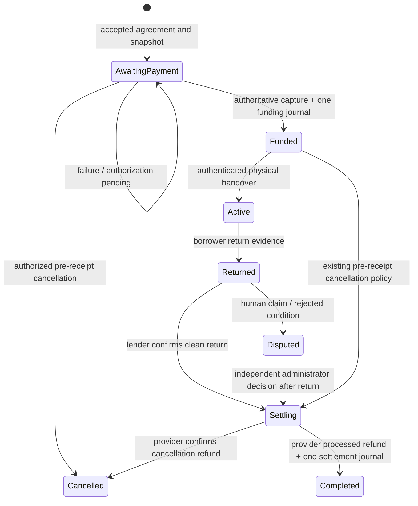

# Payment lifecycle finalization — 11 November 2026 (India time)

**Current completion:** Fresh official Test GETs verify A's ₹2,500 capture and processed ₹2,000 deposit refund, B's ₹2,500 capture and processed ₹1,400 refund after an independently approved simulated ₹600 deduction, and the preserved original ₹1 capture. Both A/B bookings are completed and settled. See the [final release audit](payment-final-release-audit-20261111.md) and [current architecture](payment-architecture.md) for current results and limitations.

The implementation and preparation evidence below describes the earlier finalization run. Its unpaid-fixture assertions and then-remaining manual steps are historical, not instructions to repeat checkout or refund. Current backend results are 289 passed / 3 PostgreSQL skips; frontend 40 passed. The final audit also identifies missing triggers in the historical SQLite database, a local signing key that fails public policy, and dependency security issues; these must not be hidden by the earlier preparation results.

This report supersedes older documentation that permits participant-finalized mutual deductions or automatic Razorpay refunds during return confirmation. Borrower consent now records a response; an independent human administrator authorizes every disputed allocation. Return confirmation creates an immutable allocation intent and does not dispatch a Razorpay refund.

## Implementation and authorization

- Agreed offers produce immutable borrower/lender, dates, rental, deposit, total and INR snapshots. Only the authenticated borrower can create or verify an order. Client amounts and extra financial parameters are rejected.
- Capture requires provider verification, matching order/payment identities, integer amounts and INR. An explicitly false capture flag is rejected. Exactly one funding reference posts the rental and deposit separately. Handover requires captured payment and funded/active state.
- Lenders submit reasoned claims against returned rentals. Borrower responses are versioned and cannot approve settlement. `/api/disputes/settle` requires an administrator who is neither participant, a nonempty reason, return photographs and a recorded return timestamp. The decision records the reviewer, reason, amount and evidence references. AI references are unverified advisory pointers and confer no authority.
- Clean, undisputed returns authorize the full deposit. Existing pre-receipt cancellation policy returns rental plus deposit after capture; unpaid cancellation requires no refund. Active/disputed rentals require the existing return/review workflow. Late capture after cancellation creates a cancellation intent and keeps handover locked.
- An early generic dispute can use the existing administrator recovery action after an independent reviewer records item recovery. Before receipt, the existing full cancellation refund applies and settlement clears the frozen liability. After borrower receipt, pre-receipt cancellation is blocked; administrator recovery can permit return evidence, after which the normal reviewed settlement applies. This prevents frozen bookings from becoming stranded without inventing a fee or deduction policy.
- `/api/payments/refunds/execute` requires literal `gateway_refund_approved: true` for Razorpay Test dispatch. It accepts no client refund amount. Only an administrator can request a new attempt after the gateway confirms terminal failure. The UI presents a separate approval checkbox and explicit dispatch button. Repeated normal execution uses the same immutable intent and provider key.
- `/api/payments/refunds/reconcile` uses gateway GETs only in Razorpay mode. It rejects `retry_failed` even when approval is supplied; a new attempt must use the execution endpoint. Unknown POST responses are recovered by matching the immutable receipt in the provider's refund collection. Reconciliation never silently creates a gateway refund. A zero-amount allocation makes no gateway call.
- Refund response checks cover the payment, exact integer amount, INR, refund-ID namespace, known ID, receipt when returned, status, live-mode flag and local ID collisions. Missing currency does not authorize a refund posting. Financial transactions, attempts, provider errors and reconciliation actions remain auditable.
- A 30-second dispatch lease, booking serialization, active-attempt fencing, immutable refund allocations, unique provider IDs and unique journal references prevent supported concurrent and duplicate requests from posting twice. Timeouts retain the deposit liability and original idempotency key. The existing `X-Refund-Idempotency` and identical retry payload match [Razorpay's documented idempotent refund contract](https://github.com/razorpay/markdown-docs/blob/master/api/refunds/normal-refunds-idempotent.md).
- Signed webhook handlers use provider GETs as authority. An early terminal refund webhook can recover an unknown local provider ID by its authoritative receipt. Superseded failed attempts cannot replace the current attempt. Processed refunds do not regress on late failed/pending events. Unknown or conflicting events remain pending/rejected rather than fabricating success.
- Live credentials, unsupported providers, capture dispatch, transfers and payouts remain blocked. The public tunnel targets only the webhook proxy. Authentication, raw-body HMAC, constant-time comparisons, minimized receipts and immutable journals remain in place.

## State summary



Payment status is `unpaid → order_created → authorized/captured/failed`, with capture terminal. Refund intents progress `created → dispatching → pending/processed/failed/unknown`. `unknown` means that reconciliation is required, not that the gateway failed. A confirmed failed refund remains reserved until an administrator authorizes a fresh attempt. `refund_reconciled` audit events distinguish reconciliation observations from requests; only provider `processed` confirms a positive refund and permits final accounting. Simulated zero-refund settlement requires no provider refund.

## Accounting invariants and acceptance scenarios

All amounts are integer paise. Every posted journal has equal positive debit and credit totals. Deposit refunded plus approved deduction never exceeds the agreed deposit; held liability cannot become negative. Journal/audit records remain append-only. Lender receivables are explicitly simulated and never invoke payout APIs.

| Posting | Debit | Credit |
| --- | --- | --- |
| Funding, either scenario | Gateway clearing ₹2,500.00 | Rental fee clearing ₹500.00; held deposit liability ₹2,000.00 |
| Dispute freeze, B | Held deposit liability ₹2,000.00 | Frozen deposit liability ₹2,000.00 |
| Settlement A | Held deposit liability ₹2,000.00; rental clearing ₹500.00 | Gateway clearing ₹2,000.00; simulated lender receivable ₹500.00 |
| Settlement B | Frozen deposit liability ₹2,000.00; rental clearing ₹500.00 | Gateway clearing ₹1,400.00; simulated lender receivable ₹1,100.00 |

The ₹1,100.00 simulated allocation in B comprises ₹500.00 rental and ₹600.00 administrator-approved simulated compensation. Both genuine scenarios now match these allocations, with one processed refund and one settlement journal per booking. The decision does not independently establish actual physical damage.

## Historical preparation state of genuine Test bookings

Both bookings collect **₹2,500.00**: rental **₹500.00** plus refundable deposit **₹2,000.00**. Both remain `order_created` / `awaiting_payment`, with handover locked.

| Scenario | Booking | Genuine Test order | Expected deposit refund after eligible return |
| --- | --- | --- | --- |
| A — full | `b74b6ff4-91b5-41e6-b16f-6fd7a4d3ead0` | `order_TyaI49iURtfrnA` | ₹2,000.00 |
| B — partial | `b60689be-73b2-47f2-992c-87e03dcf6303` | `order_TyaI58iaJg9QQ8` | ₹1,400.00, only after explicit independent human approval of ₹600.00 |

- [Scenario A checkout page](http://127.0.0.1:5175/borrow-requests/6e0788b9-2fe4-4f6b-b8ab-0f38a6900ca4)
- [Scenario B checkout page](http://127.0.0.1:5175/borrow-requests/8942f920-7ff1-4d8d-9153-470b9a57be0b)

These are authenticated application pages that launch official hosted Test checkout. They are not standalone Razorpay Payment Links. Sign in as the newly prepared fixture borrower using the private local file `backend/.payment-verification/finalization-20261111/scenario-accounts.json`. It also contains separate lender and independent reviewer fixtures. No credentials are included in this report. The accepted agreement dates are stored on the pages; recheck booking expiry if demonstrating later.

Each booking has a distinct genuine Test order. Provider payment IDs do not exist yet: only the user's manual checkout can create them. Distinct successful provider payments must be verified after those checkouts. The script did not complete checkout, generate provider signatures, apply a persistent deduction or send a gateway refund POST.

## Historical finalization verification matrix

| Workflow / check | Result | Evidence and limit |
| --- | --- | --- |
| Agreement authorization and immutable financial snapshots | PASS | Authenticated integration tests, booking ownership/amount tampering regressions, two prepared agreed bookings |
| Order idempotency, capture verification, failed/pending payments, handover gating | PASS | Disposable mock/Test-transport regressions, duplicate callbacks and wrong associations |
| Full and partial deposit refunds | PASS locally; NOT VERIFIED on genuine new payments | ₹2,500 scenario acceptance tests; real orders remain unpaid |
| Independent human deduction authority and return eligibility | PASS | Parties cannot approve even with administrator role; missing return blocks settlement; durable evidence/reason audit |
| Cancellation before and after capture | PASS locally | Existing pre-receipt policy, late-capture recovery and active-rental guards |
| Timeout, pending/failed refunds, recovery and safe retries | PASS locally | Same intent/key recovery, provider GET discovery, administrator-only failed-attempt rotation |
| Concurrent / duplicate actions, balanced journals, nonnegative liability | PASS locally | Real database locks, stale-attempt fencing, immutable allocation and exactly-one posting assertions |
| Refund identifiers, amounts and currencies | PASS locally | Mismatched payment/receipt/currency/amount/ID rejected without settlement posting |
| Signed webhook integrity, replay, conflicts and out-of-order events | PASS locally | Synthetic signatures only in disposable test databases; original-body receipt minimization retained |
| Private routes / webhook proxy / public tunnel isolation | PASS | Local and public private-route GET denials, invalid local HMAC rejection, private Host rejection |
| Genuine Dashboard-originated delivery for new scenarios | NOT VERIFIED | No manual captures yet; route reachability and signed offline tests do not prove provider origin |
| Frontend checkout and refund contracts | PASS | 35 Node tests; official hosted checkout mocked at the boundary; no genuine checkout automated |
| Desktop/mobile UI, contrast, touch targets and approval interaction | PASS for inspected surfaces | Isolated Chrome at 1280px/390px, no horizontal payment-card overflow, white-on-blue buttons, 44px targets; refund interactions use explicitly synthetic props and an in-memory callback |
| Production build | PASS | Vite build, 1,658 modules; final JS ~357 KB before gzip |
| Payment scope lint and formatting | PASS | Backend selected payment routes/services/tests/scripts: Ruff; frontend `lint:payments` and `format:payments:check`; `git diff --check` |
| Repository-wide backend lint / formatting | FAIL — existing style debt | 48 lint findings outside the clean checked payment scope, mostly import order/unused imports; legacy formatting failures remain. Raw reports are retained; no whole-repository cleanup was performed. |
| Original ₹1 transaction and all pre-existing rows | PASS | Per-row fingerprints preserve every original table row despite the new fixture additions; original credential hashes also match |
| Live capture dispatch, real payouts and marketplace transfers | PASS for application guards | Provider operation allowlist and negative tests; no real payout or transfer was attempted |
| PostgreSQL-specific concurrency / database behavior | NOT VERIFIED | Three honest skips; no dedicated local `PAYMENT_TEST_POSTGRES_URL` configured |
| Dependency audit | PASS for high/critical threshold; moderate findings remain | Targeted compatible `follow-redirects` update removed the high advisory. Three moderate findings remain in the ESLint/minimatch development-tool chain. No forced major transitive override was applied. |

At that preparation stage, the backend result was **279 passed, 3 skipped**, with synthetic gateway transport and isolated databases; frontend **35 passed, 0 failed**. Current test results and confirmed security/deployment findings are in the final release audit linked above. Neither run is a production or regulated-escrow certification.

## Files changed in this finalization

- Backend: `app/services/payments.py`, `app/services/razorpay_service.py`, `app/routers/payments.py`, `app/routers/borrow_requests.py`, `app/schemas/payment.py`.
- Regression coverage: new `tests/test_payment_finalization.py`; updated `test_razorpay_escrow.py`, `test_payment_regressions.py`, `test_webhook_ingress.py` to require independent review and explicit dispatch.
- Reproducible preparation/verification: new `scripts/prepare_sandbox_scenarios.py`, `scripts/verify_sandbox_runtime.py`, `scripts/verify_payment_browser.py`.
- UI: new `RefundPanel.jsx`, `FinancialTimeline.jsx`; updated `EscrowStatusCard.jsx`, `DisputeResolutionModal.jsx`, `paymentFlow.js`, `PaymentModal.css`, `payments.test.js`. `PaymentModal.jsx` and `PaymentReviewQueue.jsx` were formatted with the payment components.
- Tooling/documentation: frontend `package.json`, `package-lock.json`, `eslint.config.js`, `.prettierrc.json`, this report and the current-report pointer in `sandbox-only-payments.md`. Existing unrelated uncommitted work is retained. No Git branch, commit or push was created.

## Reproduction and evidence

Run from `backend/` with the existing FastAPI Python environment. On this machine it is `D:\Anaconda_Install\envs\neighbourlend_yolo\python.exe`; the shell's default Python is not the backend runtime.

```powershell
$env:PYTHONPATH = '.test-tools;.'
$env:PYTEST_DISABLE_PLUGIN_AUTOLOAD = '1'
& 'D:\Anaconda_Install\envs\neighbourlend_yolo\python.exe' -B -m pytest tests -q --tb=line -rs --basetemp=.payment-verification/fresh-finalization-run/tmp -o cache_dir=.payment-verification/fresh-finalization-run/cache
```

Use a fresh artifact directory for a new run. Conftest shadows configured credentials and forbids real provider network transport. From `frontend/`, run `npm test`, `npm run lint:payments`, `npm run format:payments:check`, and `npm run build`.

Preparation is resumable for these specific isolated fixtures: `python -B scripts/prepare_sandbox_scenarios.py --prepare`. It can create Test orders, so it is not an automated regression command. `python -B scripts/prepare_sandbox_scenarios.py` only verifies preservation. `python -B scripts/verify_sandbox_runtime.py` checks running local services; `--reload-owned-stack` validates and reloads only the recorded owned API/controller/proxy against the same database without migration. `python -B scripts/verify_payment_browser.py` uses installed Chrome and websocket-client with an isolated profile, blocks Razorpay requests and tests refund UI using an in-memory callback.

Evidence is private and ignored under `backend/.payment-verification/finalization-20261111/`: `backend-final.xml`, `frontend-tests.txt`, `scenario-verification.json`, `preservation-baseline.json`, `runtime-verification.json`, `browser-verification.json`, `npm-audit.json`, repository lint/format output, and desktop/mobile PNGs. Earlier historical audit evidence was not rewritten.

The first full implementation run found two stale webhook tests calling reconciliation to start refunds; those tests now explicitly approve execution. The final state review added two regressions for early-dispute recovery. Its targeted run caught an existing administrator item-recovery cancellation exception that the first recovery guard was too strict to preserve; that guard was corrected while retaining the received/disputed-item return restriction. An initial test collection used the wrong Python environment and was discarded. An early browser layout assertion was followed by saved observations and a final successful run that waits for page animations/fonts. These intermediate failures are not reported as successful runs.

## Historical manual gateway steps — completed, do not repeat

Steps 1–3 below were subsequently completed by the user. Provider IDs, processed refunds and journals were independently read in the final audit. Only independent Dashboard delivery provenance remains unverified from step 4. The current next UI action is **Refresh payment status**, a booking GET; no new financial action is needed.

1. Sign in with the new fixture borrower and manually complete each official Test checkout. Do not use the preserved ₹1 booking. The application must verify each distinct provider payment before handover.
2. Perform the existing authorized physical handover and return steps with genuine scenario evidence. A clean return in A authorizes ₹2,000.00. In B, submit the simulated ₹600.00 claim and obtain an explicit independent administrator decision with reason and evidence before any persistent deduction authorization.
3. Approve each external Test refund explicitly: ₹2,000.00 for A and ₹1,400.00 for B after its decision. Return confirmation and ordinary reconciliation do not send these POSTs. Reconcile until the provider confirms `processed`; do not infer success from a timeout, request receipt or pending state.
4. Record the resulting provider IDs, processed refunds and balanced journals. Obtain matching Dashboard delivery records to independently verify genuine webhook origin. No historical HMAC or delivery evidence will be fabricated.

These manual checkout and financial approval boundaries come directly from the user's attached request. All available local implementation and verification work has been completed without crossing them.
