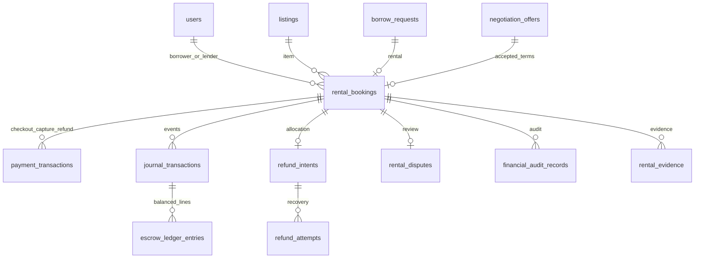

# Supabase payment tables — verified 12 November 2026 (IST)

These tables **exist in the shared hosted database**, in `public`. Open the
[Supabase Table Editor](https://supabase.com/dashboard/project/lgurfoppprubxbclpoqk/editor),
select `public`, and refresh the table list if it was already open.

| Table | Purpose | Rows after migration | RLS |
| --- | --- | ---: | --- |
| `rental_bookings` | Accepted rental, participants, integer-paise terms, deposit lifecycle | 0 | Enabled |
| `payment_transactions` | Durable checkout orders, verified captures and refund transactions | 0 | Enabled |
| `journal_transactions` | Unique business events and balanced posting headers | 0 | Enabled |
| `escrow_ledger_entries` | Immutable double-entry lines; simulated accounting | 0 | Enabled |
| `refund_intents` | Immutable authorized refund and compensation allocation | 0 | Enabled |
| `refund_attempts` | Dispatch/reconciliation attempts and provider references | 0 | Enabled |
| `rental_disputes` | Versioned claims, responses, independent admin decision/reason | 0 | Enabled |
| `processed_webhooks` | Signed, deduplicated, redacted event inbox | 0 | Enabled |
| `financial_audit_records` | Append-only financial authorization/transition history | 0 | Enabled |
| `rental_evidence` | Private handover/return evidence references | 0 | Enabled |
| `payment_schema_versions` | Migration history: versions 2 and 3 | 2 | Enabled |

Financial rows are intentionally empty. No users, listings, offers or transactions
were recreated or inserted to populate the editor. Fresh records will come from
the existing workflow; new Razorpay sandbox financial operations need separate
authorization.

The original ten application tables remain. Public now has **21 tables, 77
constraints and 18 application triggers**. Original rows passed before/after
count and original-column fingerprint checks. A private verified `pg_dump` backup
was made first. Browser roles `anon` and `authenticated` have no direct financial
table or trigger-function privileges. FastAPI checks application JWT identities;
Supabase `auth.uid()` is not assumed to match application varchar user IDs.

The webhook inbox reconciles provider identities rather than trusting incoming
notes as foreign keys. Deposit liability and lender payables reuse the existing
booking/transaction/refund/ledger records. No competing order, deposit or rating
platform was created. `lender_settlement` in the API explicitly reports simulated
earnings/compensation with `provider_transfer_verified=false`.

See [the verification report](payment-master-verification-20261112.md) and
[the applied SQL](../backend/migrations/payments/003_supabase_financial_guards.sql).
