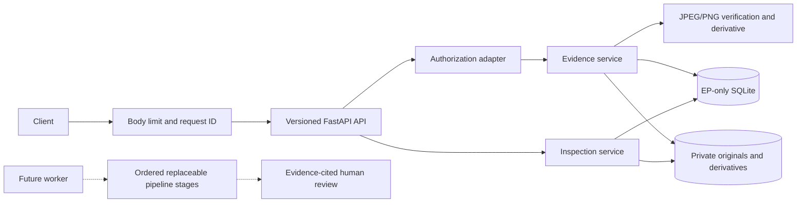
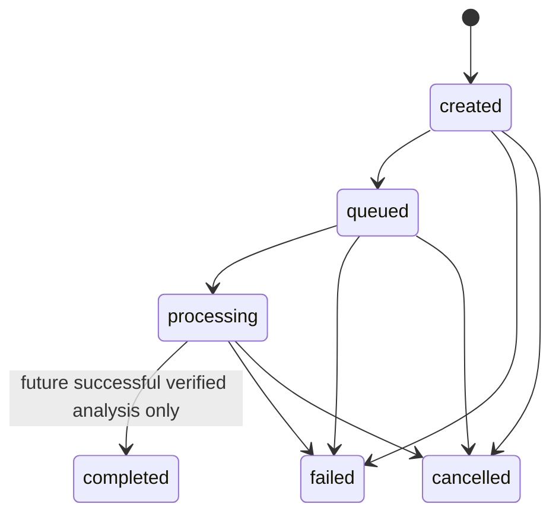

# Architecture

Phase 1 supplies ingestion, private local storage, SQLite persistence, authorization
boundaries, typed contracts and truthful inspection records. Inference is unavailable.

`create_app` accepts Settings and an Authorization implementation. Lifespan initializes
only EP state. Importing the package creates no database or model. FastAPI dependencies
expose the services for isolated replacement and failure injection. Blocking Pillow,
SQLite and filesystem operations run in worker threads, not on the event loop.

Request boundaries reject excessive raw/chunked bodies before JSON decoding, issue
server-generated UUID correlation IDs, and sanitize errors. CORS defaults to no permitted
origins. Raw image requests avoid multipart disk-spooling outside EP. Limits bound each
request; process-wide concurrency/rate limits remain a deployment concern.

The image service verifies JPEG/PNG containers then fully loads pixels, rejects animated
and decompression-bomb inputs, applies EXIF orientation to a separate RGB PNG derivative,
and strips derivative metadata. Width/height describe that corrected frame. SHA-256 and
byte size describe the untouched original. Client capture dates/viewpoint labels are
always unverified. Original EXIF/GPS may contain sensitive data and stays private.

SQLite schema version 1 uses `PRAGMA user_version`. Unknown versions fail startup.
Evidence records include indexed rental, stage, subject, digest and a versioned JSON
record. A unique constraint provides scoped duplicate handling. Inspections have
versioned JSON records and a foreign-key link table tying them to evidence.

Each operation uses a fresh connection, enabled foreign keys, and `BEGIN IMMEDIATE`.
Uploads hold that database write lock across duplicate lookup, temporary file writes,
atomic promotions and metadata insert/commit. Database/file allocation checks prevent
identifier collisions from overwriting prior bytes, and cleanup removes only files owned
by the current upload. Both representations are flushed and
fsynced. Exceptions trigger database rollback and file cleanup. If cleanup cannot finish,
startup recovery removes unreferenced files under the same lock. Global hashes are not
exposed or used to deduplicate across unrelated users/rentals. Duplicate metadata is
first-write-wins and never silently changes the existing record.

Recovery verifies both hashes, marks affected evidence `invalid`, removes orphan files,
and marks interrupted `processing` inspections `failed/restart_interrupted`. Queued
and created records remain pending. Do not run multiple service workers against one
development data directory: startup recovery assumes an exclusive process lifecycle.
SQLite/filesystem atomicity cannot guarantee survival of arbitrary hardware failure;
backups, OS durability policy and remote adapters require separate validation.

The legal lifecycle is:

Terminal states cannot transition. Phase 1 rejects **every** transition to `completed`,
including from `processing`; no HTTP state-mutation or processing endpoint is exposed.
`completed_at` records terminalization for failure/cancellation too, not analysis success.
Inspection creation checks role-independent rental participation, before/after stage
selection, uniqueness, both evidence hashes, and persists the links in one transaction.
No analysis job is queued automatically.

Future pipeline order is quality → segmentation → visual features → viewpoint matching
→ alignment → change candidates → damage verification → fusion → report. Nine Protocol
interfaces share versioned PipelineContext/StageResult envelopes: evidence IDs, prior
results, opaque artifact keys, observations, limitations, findings and explicit abstention.
Each implementation must separately version its masks/embeddings/transforms encoding.
The orchestrator isolates stage input copies, checks stage order and evidence citations,
sanitizes unexpected stage failures, propagates domain errors and stops on abstention.
Contract tests use synthetic adapters solely to test orchestration, never to claim inference.

Identity, physical damage and financial responsibility are separate questions. Similarity
does not prove identity; image differences do not prove damage; an LLM description is not
independent proof. Unmatched/occluded/unobserved reference regions require inconclusive
results. Model self-reported confidence is not a calibrated probability. Any future
finding must retain evidence citations, contradictory observations and human review.
