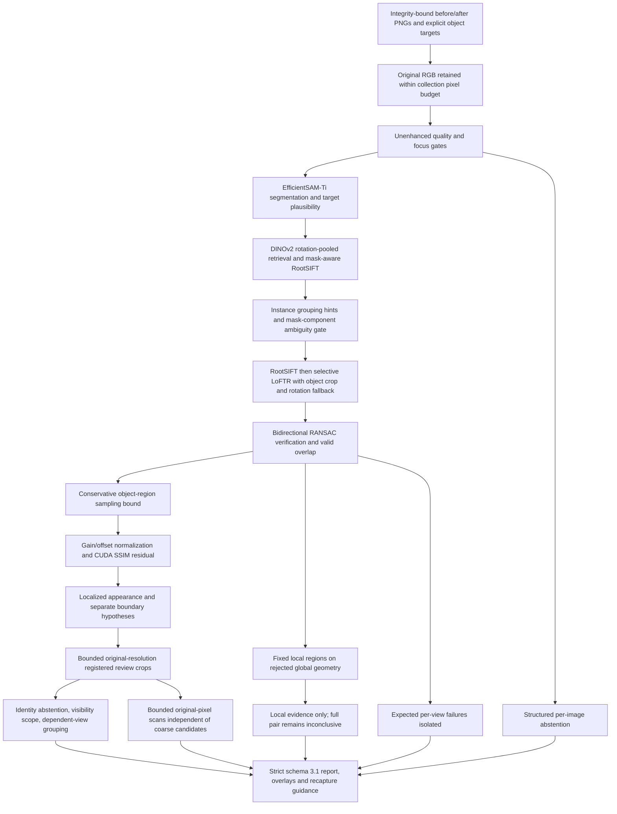

# EP Engine v3.1 standalone inspection

Implemented 11 November 2026 (Asia/Calcutta). See the generated
[release evaluation](ep-v31-release-report.md) for actual measurements and verdict.
The subsequent [refinement evaluation](ep-v31-refinement-report.md) records the
current implementation, additional experiments, and regression results. The original
release report and its frozen evidence remain historical records.
The engine provides localized visual evidence for human review. It has no financial
authority, external assessment calls, application integration, or database connection.



## Public API and execution

Use the approved existing Windows Conda interpreter. Optional Kornia packages are
already installed privately inside EP; no installation or download is needed.

```powershell
$epPython = 'D:\Anaconda_Install\envs\neighbourlend_yolo\python.exe'
$env:PYTHONPATH = '.runtime/v3-packages;.'
& $epPython -B scripts/run_v31.py .runtime/private-inspection/input.json --output .runtime/private-inspection/run-v31-001
```

The new output directory must be private, inside `ep/`, and absent before launch.
The launcher takes the existing Windows worker lock and enforces the configured
subprocess timeout (180 seconds default). It writes `result.json`, private
`worker.log`, optional failure traceback, and cited PNG artifacts. Never serve
these directories publicly. Existing `run_v3.py` and v2 interfaces remain available.

The request retains the [v3 evidence format](ep-v3.md): `inspection_id`, `config`,
and `evidence`. At least one `before` and one `after` image with distinct UUIDs are
required. Every image is an integrity-bound, orientation-corrected PNG named for
its UUID inside EP; source SHA-256 and derivative SHA-256 have separate meanings.
Each capture accepts `view`, normalized `target`, and optional `instance_id`.
Different explicit view labels prevent pairing. Instance labels are operator hints,
not physical identity evidence; mismatched or incomplete instance assignments abstain.
`object_metadata` accepts descriptive strings but never establishes identity.
`high_resolution_crops` defaults to four and is bounded to eight.
`surface_observation_budget` separately defaults to four and is bounded to eight;
zero disables the additional surface artifacts. Existing total artifact and byte
budgets still apply.

The strict [request schema](ep-v31-request.schema.json) and
[report schema](ep-v31-report.schema.json) reject unknown fields and nonfinite values.
The report contains the unchanged 2.0 `cv_package` contract inside a 3.1 envelope.
`engine_version` and algorithm revision distinguish the implementation version.

```python
from pathlib import Path
from ep_engine.v31 import inspect

report = inspect(payload, Path('ABSOLUTE_PRIVATE_EP_OUTPUT/artifacts'))
assert report.payment_action == 'none'
serialized = report.model_dump_json()
```

`inspect_inputs(inspection_id, inputs, artifact_dir, config, ...)` is the in-memory
adapter for existing `InputImage` callers and optional model injection in tests.
Callers supply orientation-corrected RGB uint8 arrays, source digests, and explicit
targets. The manifest loader verifies derivative bytes; the in-memory adapter trusts
the caller's declared original-file digest. Source arrays are not modified.
In-process callers serialize GPU work and enforce their own deadline; use the
launcher for the supported isolated execution boundary.

## Meaning of the evidence

- DINO similarity retrieves candidate views; it never proves physical identity.
- Local correspondence plus geometry supports local visual consistency only.
- Exact pixels are recorded as the same capture, never as independently verified
  physical identity or a genuine unchanged recapture.
- Every physical identity assessment currently abstains. No reviewed distinctive
  identifier has been supplied or validated by this implementation.
- Zero confirmed identities on different-object controls is a successful abstention
  gate, not evidence of positive physical-identity recognition accuracy.
- Appearance and boundary observations remain hypotheses. The possible-damage list
  is intentionally empty while physical identity and cause remain unverified.
- `no_localized_change_detected` means the candidate detector returned no localized
  proposals in its assessed overlap; it does not establish absence of damage.
- Coverage is the after-mask processing overlap fraction, not full 3D surface
  coverage. Unseen sides and fine detail outside original-resolution crops remain
  unassessed. Reflection, shadow, flexible parts, clock hands and occlusion remain
  alternative explanations.
- Scores are uncalibrated evidence scores. No confidence probabilities are emitted.

`surface_observations` contains separately cited appearance evidence. Each observation
includes registered before/after crops, a valid-overlap mask, a difference map,
normalized source-coordinate region boxes, observed mask coverage, sampling floor,
and registration uncertainty. These observations never populate possible damage
hypotheses. A `local_correspondence_hull` observation does not change an inconclusive
pair into a comparable pair. Its geometry supports only the cited local region.
An `original_resolution_tile` can find differences absent from thumbnail candidates;
unscanned regions remain unknown. Near-duplicate views are not independent evidence.

Mask components at two bounded erosion scales signal possible independently movable items
connected by thin segmentation bridges. Ambiguity abstains rather than assigning
one transform to separate items. Touching/overlapping instances can remain unresolved.
Supply separate tight instance targets as separate evidence records with matching
grouping hints; each accepted pair gets its own transform. Missing/additional targets
are unmatched evidence, not proven lost or added physical components.

Multiview reports retain each view, preserve successful views when another fails,
and group near-duplicate observations without claiming independent corroboration.
Cross-view surface correspondence and contradictions are explicitly unestablished;
no whole-object condition conclusion or automatic damage promotion is made.

## Geometry, resolution and resource limits

The existing inlier count (12), ratio (0.45), spatial support (3%), reprojection
limit (3 processing pixels), quality gates and overlap threshold (0.35) remain.
Both matchers use foreground filtering, endpoint uniqueness, symmetric error and
transform validation. CUDA optional-method failure retains defensible CPU evidence.
Unexpected programming failures propagate as stage failures with private cause chains.

The object sampling bound is analytical over the object-mask bounding rectangle:
projective Jacobian numerators are linear, denominator minima occur at corners,
and the spectral norm of elementwise absolute bounds bounds magnification throughout
that rectangle. It avoids background-only corners dominating the supported object
region. Dense derivative regression checks verify the bound; identity and rotation
controls preserve original sampling. The baseline global estimate remains in v3.

The retained 180-degree LoFTR fallback is attempted only when existing matching
has no valid transform and DINO retrieval remains compatible. Returned coordinates
are remapped into the original after-image frame before the unchanged verification
and overlap gates. The bounded rotation experiment recovered phone-back; quarter-turn
alternatives on full frames did not produce a validated gain. The refinement
experiment subsequently recovered phone-front by cropping to the object before
a quarter turn. Up to four crop orientations are now attempted only after existing
matching fails, preserving foreground filtering, endpoint uniqueness and all
verification thresholds. Source coordinates are restored before geometric fitting.
Native crop matching at 512/640 pixels did not recover additional rejected pairs
and was not added to runtime.

For nonrigid surfaces, the refinement tests four fixed source-mask quadrants against
the same inlier count, ratio, spatial support and bidirectional error gates. It does
not repeatedly remove outliers until a fit passes. Both verified correspondence
hulls restrict local overlap. At most one local region per rejected pair and four
per inspection are retained. Full-view comparison and boundary claims still abstain.
The mask-scale experiment found two substantial lobes in the touching-shoe return
mask, so that combined target abstains. Mask erosion is an ambiguity check and never
changes the stored segmentation or assigns physical instance identities.

Original data is retained separately from the unchanged Pillow processing thumbnail,
so comparison conditions remain matched to baseline. Candidate review crops use
original pixels, transformed into the after-source crop frame, at most 1024 pixels
per side, without sharpening or artificial upscaling. Their valid-overlap mask is
cited explicitly. These candidate crops improve review detail. The separate original
scan examines up to four fixed windows per eligible view, within its inspection
budget, distributed across views before taking second windows. It can emit localized
appearance regions without a coarse candidate. Pixel-center transforms account for
different processing/source sizes; both registered images use matching interpolation.
Sampling floors are pixel-sampling bounds, not calibrated minimum
detectable scratch sizes. Registration uncertainty is separately reported.

Limits: 16 million source pixels per image, 64 million per retained collection,
768-pixel default processing side (1024 maximum), eight images by default (12 maximum
configuration), 16 pair candidates by default, 4096 correspondences per RANSAC,
150 artifacts / 32 MB per inspection, up to eight review crops. Actual measured
workloads and memory peaks are in the release report; larger configured combinations
are not claimed benchmarked merely because validation permits them.

EfficientSAM and DINO run sequentially in inference mode; DINO is released before
LoFTR. On CUDA, the four 224-pixel DINO rotations now use one measured FP32 batch;
CPU retains sequential forwards. Exact image-and-target mask results use a bounded
12-entry CPU cache with defensive copies. FP32 remains: no experiment justifies
AMP precision changes. Embeddings use
the existing bounded content/weight-bound CPU LRU with defensive copies. Geometry
and alignment stay CPU by default; CUDA SSIM has bounded, recorded CPU fallback.

Windows artifact promotion normally uses directory rename. Reproduced WinError
5/32/33 uses a bounded verified-manifest copy to a newly created private directory
inside the same database transaction, followed by digest/PNG revalidation. It never
overwrites an existing artifact directory, relaxes ACLs or retries indefinitely.
Partial copy or transaction failure rolls back publication and deletes only the
new private target. Original photographs and frozen baseline artifacts are untouched.

## Reproduce evaluation

The frozen pre-edit source, historical evidence copy, source checksums, dataset
checksums and Git state are under `.test-artifacts/ep-v31-20261111/`. No commit,
branch, checkpoint, original photo, payment artifact or application file was changed.

```powershell
& $epPython -B scripts/evaluate_v31.py baseline --campaign complete
& $epPython -B scripts/evaluate_v31.py current --campaign release
& $epPython -B scripts/probe_v31_matching.py
& $epPython -B scripts/probe_v31_instances.py
& $epPython -B scripts/benchmark_v31_lifecycle.py baseline
& $epPython -B scripts/benchmark_v31_lifecycle.py current
& $epPython -B scripts/audit_v31.py
& $epPython -B scripts/report_v31.py
$env:EP_RUN_REAL_CV = '1'
$env:EP_RUN_CONTROLLED_CV = '1'
$env:EP_RUN_V3_CUDA = '1'
& $epPython -B scripts/verify.py all
& $epPython -B scripts/verify.py lint
& $epPython -B scripts/verify.py format
```

Evaluation resumes completed cases without overwriting them. To rerun into a new
directory use `--campaign ANOTHER_NAME`; the report generator uses baseline `complete`
and current `release`. Earlier current campaigns are preserved separately.
Frozen baseline imports its archived source package while binding paths to the same
audited original assets and image derivatives. Seeds, imports, source hashes,
per-stage timings, model-load timings, failure traces and configs are retained per
job. CUDA is not promised bit-for-bit deterministic.

Current real photographs, historical captures, exact-pixel repeats, different-category
identity controls and generated software controls are kept distinct. Archived
before/after duplicates are not independently captured unchanged examples. No damage
labels or physical-object holdout were invented. Precision, recall, F1, physical-damage
false-positive rate and localization accuracy remain N/A without independent labels.
