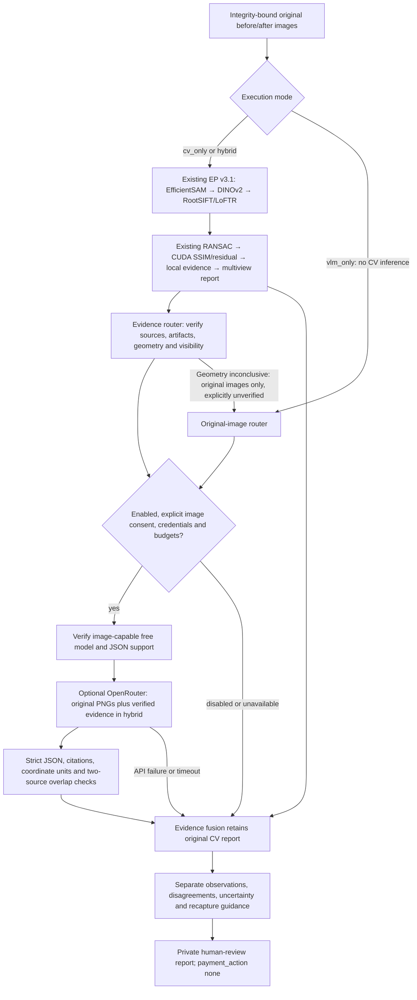

# Optional OpenRouter reasoning for standalone EP v3.1

The existing `ep_engine.v31.inspect` and isolated `scripts/run_v31.py` remain local
and unchanged. The new `ep_engine.vlm_eval.api.inspect` adds a separate report
envelope around CV evidence and optional model opinions. It has no application,
database, identity-confirmation or financial authority. See the
[live-hybrid acceptance](openrouter-v31-hybrid-acceptance.md) for the latest measured
result, and [finalization](openrouter-v31-finalization.md) for native/memory evaluation.
The [initial verification report](openrouter-v31-report.md) is preserved as history.



## Execution modes

* `cv_only`: the wrapper executes the existing CV API without creating a VLM worker.
  Original v3.1 callers continue receiving exactly their existing report contract.
* `vlm_only`: the wrapper loads and verifies original captures without executing CV.
  The model's observations remain unverified, even when citations and JSON are valid.
* `hybrid`: CV runs first. Supported pairs receive verified CV evidence. Inconclusive
  geometry routes original images to an independent visual-only comparison, with an
  explicit geometry warning and no CV change proposals. The same consent, privacy
  and request budgets apply. Its model opinions remain visible but its supported
  change prediction is always unknown; fusion independently enforces that rule.
  Opposing positive/negative CV and VLM observations force uncertainty.
  A failed model call preserves the full CV result and returns `cv_fallback`.

The evaluation command replays existing verified CV reports instead of timing a new
CV inference. It compares the same available cases in all three modes. Never compare
its CV replay latency with GPU inference latency as a speedup measurement.

## Configuration and consent

The explicitly named `.env` file is read only. The loader reads these six names;
it never imports backend configuration or executes dotenv content. Process values
take precedence. Secret values never appear in receipts or request bodies.

| Setting | Meaning |
|---|---|
| `EP_VLM_ENABLED` | `false` disables all VLM API calls, including metadata calls |
| `EP_VLM_PROVIDER` | `openrouter` when enabled |
| `OPENROUTER_API_KEY` | Server-side credential; presence only is reported |
| `OPENROUTER_MODEL` | Explicit image-capable `author/model:free`; no automatic model fallback |
| `OPENROUTER_BASE_URL` | Only `https://openrouter.ai/api/v1` is accepted |
| `OPENROUTER_TIMEOUT_SECONDS` | Absolute worker timeout, at most 60 seconds per attempt |

Environment enablement is not image-export consent. API callers separately set
`Limits.allow_external=True` only after consent for the selected photos/destination.
The CLI requires `--consent-external-images`. Default request budget is zero in the
new CLI. A run directory has a durable, append-only request ledger; failures consume
reservations and never cause an automatic budget reset.

The OpenRouter adapter is intentionally free-only. It verifies image/text modalities,
JSON support, context capacity and zero catalog prices before generation. Requests
enforce zero prompt/completion/image/request price caps, `data_collection=deny`,
`require_parameters=true`, and no routing fallback. Account privacy restrictions
still apply. Catalog availability does not establish a compatible live route.
These controls follow [OpenRouter image inputs](https://openrouter.ai/docs/guides/overview/multimodal/image-understanding),
[structured output](https://openrouter.ai/docs/guides/features/structured-outputs), and
[provider routing](https://openrouter.ai/docs/guides/routing/provider-selection).

The configured NVIDIA free endpoint documents collecting session data for product
improvement. That is incompatible with this run's deny-collection consent. Do not
relax the restriction to make a smoke test pass. See the
[model's published data notice](https://openrouter.ai/nvidia/nemotron-3.5-super-vl:free).
Sanitized route diagnostics confirmed a privacy-policy 404 for that model.
An explicitly selected alternative, `dots-studio/dots-3-note-preview:free`, accepted
deny-collection routing and returned a validated live image comparison. The `.env`
model was not rewritten; an operator can select an audited free route using `--model`.
Provider policy enforcement is not an independent audit of downstream data handling.

## Reliability and evidence safety

Original source-resolution RGB pixels are re-encoded into PNG without EXIF/GPS/text
metadata. Background details remain visible; preprocessing does not anonymize them.
No public image hosting, remote image URL, proxy, redirect or model download is used.
Image bytes/count, input pixels, response bytes, output tokens, request count and
run admission time are bounded. Images that exceed budgets are refused, not silently
downsampled. Existing CV thresholds and GPU resource guards are unchanged.

OpenRouter has no model-independent exact input-token preflight in this adapter.
Input usage is checked after a reply; the receipt marks token preflight unavailable.
Zero-price routing bounds spend, and `max_tokens` bounds output. A generic exact
input-token bound is not claimed. Actual cost is recorded only when returned;
zero local estimates are not a provider invoice. Completion usage already includes
reasoning tokens and is not double-counted.

One OS-locked OpenRouter operation is admitted per host across campaigns. A persistent
timestamp spaces requests by three seconds by default. Contention fails closed.
Advisory locks release if a worker dies. Only transient metadata GET failures retry
once by default. Generation retries default to zero; optionally one explicit HTTP
429 rejection may retry with a new reservation. Timeouts, transport errors, malformed
output and server errors never trigger another generation automatically.

Responses must contain one untruncated JSON object and no tool calls. Remote schema
constraints are compact to avoid grammar expansion; the complete local Pydantic
contract is mandatory. Every positive requires before/after descriptions, source IDs,
normalized boxes, explanations and alternative causes. OpenRouter replies must
include recapture guidance. Invalid units/citations are rejected, never silently
repaired. Image text and model prose are untrusted data and never execute tools.
The remote schema requires every output field, including recapture guidance and
safety flags. It restricts source IDs and attached evidence IDs to those supplied.
Change observations must be empty for no-change/uncertain replies. Every positive
must cite both originals; optional crop citations cannot replace source citations.
The updated source-citation schema passed the final live hybrid request: both originals,
attached evidence and normalized coordinates validated. The returned boxes extended
outside verified overlap, so the combined report correctly remained uncertain.

Hybrid positives must lie wholly in verified overlap in both sources with intersecting
projected regions. Rejected geometry cannot be overridden. A negative cannot erase
positive CV evidence; a positive contradicting scoped CV negatives remains uncertain.
Exact-repeat VLM allegations do not become supported hybrid changes. No output can
set physical identity verified, confirmed damage, or a financial action.
Unverified visual-only opinions for inconclusive geometry bypass none of these
gates: their supported hybrid change is always unknown and their decision uncertain.

Caches bind model, provider, credential-scope digest, prompt/schema/transport revision,
original pixel hashes, mode and CV evidence. Hits revalidate schema, citations and
geometry. Cache entries contain structured replies and usage, never credentials or
original-image bytes. Invalid replies are quarantined separately for private diagnosis.
All outputs are EP-local and must remain private; do not expose them through a server.

## Run and inspect output

Run from `ep/` with the existing approved interpreter and packages:

```powershell
$epPython = 'D:\Anaconda_Install\envs\neighbourlend_yolo\python.exe'
$env:PYTHONPATH = '.runtime/v3-packages;.'
& $epPython -B scripts/run_optional_vlm.py verify --env-file ../backend/.env --check-model
& $epPython -B scripts/run_optional_vlm.py inspect --env-file ../backend/.env --input .runtime/private-inspection/input.json --output .runtime/private-inspection/optional-001 --mode cv_only
# Only with consent for the named photos and a new, bounded authorized campaign:
& $epPython -B scripts/run_optional_vlm.py evaluate --env-file ../backend/.env --model dots-studio/dots-3-note-preview:free --input .test-artifacts/vlm-evaluation-20261111/pilot-manifest.json --output .test-artifacts/PRIVATE_NEW_CAMPAIGN --consent-external-images --max-requests 3 --max-images 5 --disable-reasoning
```

The fresh-inspection output directory must not already exist. `inspection.json`
contains the combined report; `cv-result.json` retains the full existing CV report;
`vlm-result.json` records optional-call diagnostics. Benchmark outputs include schemas,
per-case combined reports, result records, summary, hashes and request ledger.

```python
from ep_engine.vlm_eval.api import inspect
from ep_engine.vlm_eval.contracts import Limits

report = inspect(payload, private_output, mode='hybrid', limits=Limits())
assert report.payment_action == 'none'
assert report.physical_identity_verified is False
assert report.confirmed_damage is False
```

In-process callers retain the existing obligation to serialize GPU work and enforce
their CV deadline. For supported isolated CV execution, run `scripts/run_v31.py`
first and enrich its verified evidence using the benchmark/enrichment path. This
module is not an application endpoint, scheduler, database workflow or deployment.
Independent condition labels and a held-out paired study are still required before
claiming detection benefit, calibrated uncertainty, or application readiness.
