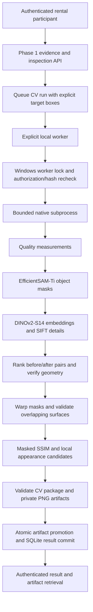

# Phase 2 architecture

The implemented pipeline produces a versioned CV sub-result from authorized before/after
evidence. It never completes a Phase 1 inspection or makes a physical-damage decision.
All execution uses native Windows and the existing approved Conda interpreter. Models
run frozen in inference mode; no additional packages or native extensions were installed.

## Interfaces and state

`cv/contracts.py` defines schema `2.0` and pipeline `ep-cv-2.0`. `CVPipeline` connects
the existing first six stage protocols through `Orchestrator.run_cv`. The original
nine-stage `Orchestrator.run` retains its requirement for all later verification stages.
No fake LLM adapter fills the remaining stages.

`CVService` repeats Phase 1 rental authorization, evidence stage/validation checks and
original/normalized SHA-256 verification when queuing and before/after execution. Source
UUIDs and hashes must match the worker's package. Source-stage reversals are rejected.
Every quality/segmentation entry covers one source exactly once; masks and candidates
require valid citations, and candidates require a comparable supporting pair.

CV records live in a separate version-1 database at `<EP_DATA_DIR>/cv/cv.sqlite3`.
Their transitions are `queued -> processing -> completed|failed|cancelled`; a queued run
can also be cancelled. `completed` means its validated CV sub-result was persisted.
Parent inspections remain `created`, with analysis `unavailable`, preserving Phase 1.
Analytical outcomes are `comparable`, `partially_comparable`, or `inconclusive`.
The package schema also reserves `failed`; execution failures currently persist a failed
run with a typed error and no usable result package.

## Image processing

Raw uploads remain Phase 1 bounded JPEG/PNG requests. The worker reads only server-selected
UUID-named normalized PNG derivatives beneath EP, validates their hashes and bounds,
then resizes once to the configured processing dimensions (default maximum side 768).
The hard worker input limit is 16 million pixels and inference maximum side is 1024.
These CV limits may be stricter than customized Phase 1 upload limits.

Quality records include dimensions, Laplacian focus variance, contrast standard deviation,
mean exposure, clipped pixel fractions, mask area and frame contact. Thresholds are
configurable and explicitly experimental (`cv-thresholds-2.0-experimental`). High resolution
alone is insufficient. Missing target selection and unusable views remain inconclusive.

EfficientSAM receives an explicit normalized box per evidence image, with corner prompt
labels 2 and 3. The highest predicted IoU mask is chosen from the model's three outputs;
this score selects a mask and is not a calibrated accuracy/confidence claim. Empty,
near-full, incorrectly shaped and nonfinite outputs are rejected. The adapter never
chooses the largest visible object as the rental item.

DINOv2 uses the masked object bounding crop, neutral RGB `(124,116,104)` outside the mask,
bicubic resize of the shorter side to 256, center crop 224 and ImageNet RGB normalization.
Extreme aspect ratios above 16 are refused before resize. Embeddings must be finite,
384-dimensional and normalized to unit length. Full supported object regions also retain
SIFT details, so the center crop is not the only source of correspondence evidence.

Before/after combinations are ranked by embedding cosine similarity, independent of upload
order. Mutual Lowe-ratio SIFT matches (0.75) and RANSAC (3 processing pixels) provide local
support. Minimum inliers, inlier ratio, spatial spread, reprojection error and transform
stability must pass. Reflections, degenerate/extreme warps and insufficient overlap are
rejected. Each return view selects its best supported reference; a reference can support
several returns. Unselected alternatives and unmatched sources remain explicit.

Identity is `consistent_visual_evidence` only after local geometric support, otherwise
`uncertain`. Neither state proves physical identity. Similar manufactured items, unseen
surfaces, reflections, nonplanar geometry and occlusions remain limitations.

Alignment warps the before mask into after coordinates. Only the eroded intersection
of both masks is compared. The detector uses a 7x7 Gaussian-window SSIM map (sigma 1.5),
median additive illumination correction, an absolute-intensity gate, morphology and
connected components. Tiny and excessively broad components are excluded. Outputs are
`local_appearance_change`, never confirmed scratches, cracks, dents or liability.

## Coordinates and artifacts

Boxes are normalized to orientation-corrected source images. Source and processing
dimensions are both recorded. Pair homographies map **before processing pixels to after
processing pixels**. After candidate boxes are inverse-projected to before coordinates;
both normalized boxes are retained. Difference maps/overlays/overlap masks use after
processing dimensions; object masks use their source's processing dimensions. Feature
visualizations concatenate the two processing images. Candidate crops carry source UUIDs.

Private artifacts include masks, object crops, feature correspondences, valid overlap,
difference maps, candidate overlays and before/after region crops. UUID metadata records
kind, dimensions, bytes and SHA-256 without paths. Writer limits: 150 PNGs and 32 MB total;
each dimension <=2048. Commit and reads check the complete manifest, PNG format/dimensions,
size and hashes. There is no static evidence/artifact mount.

## Execution, bounds and recovery

HTTP queues work but never runs GPU inference. An explicit worker launches a native hidden
subprocess with a fixed executable/module/argument list, no shell. It polls cancellation,
enforces the request deadline (default 180 seconds), terminates timed-out work and kills it
if termination does not finish within five seconds. Failed partial artifacts are removed.
Sanitized private diagnostics retain exception type and stack locations, not exception
text or submitted image data.

SQLite permits at most four pending runs per data directory. A Windows byte-range file
lock at `ep/.runtime/cv-worker.lock` allows one service worker or recovery operation across
all EP data directories. The OS releases it on process exit. Startup during active work
returns `worker_busy` instead of deleting live work; retry startup after that worker exits.
Direct development model probes are separate tools and should be run alone.

At startup, interrupted processing runs fail with `worker_interrupted`, orphan work and
unreferenced artifacts are removed, and damaged completed artifacts invalidate their run.
Commit failure after directory promotion removes the promoted directory after rollback.
The queue is locally persisted but has no scheduler, distributed lease, automatic retry or
production delivery guarantee. Operators explicitly execute queued runs.

## Model and resource trust

Only the immutable approved asset list is accepted. All 26 files are confined to
`.runtime/models/`, size/Git identities where available are checked, and subsequent loads
require their SHA-256 receipt. Unexpected files and redirects are rejected. Official pinned
modules were reviewed before import; no remote hub loader or unrestricted pickle fallback
is used. `torch.load(weights_only=True, map_location='cpu')`, finite tensors and strict
state keys/shapes precede device transfer. The DINO checkpoint has a disclosed first-download
HTTPS trust limitation; a locally recorded SHA-256 is not a publisher signature.

The adapter rechecks at least 1.5 GiB free host RAM and 2 GiB free GPU memory before model
loading. These are conservative engineering guards, not measured model requirements.
Batch size is fixed at one, Torch threads at most four, OpenCV threads one, inputs/pairs
are bounded, and models load sequentially. Only one pretrained model is retained at once.
CUDA OOM triggers cleanup and a typed failure; CPU or `auto` is explicit and does not
silently retry an OOM. Timing, load times, RSS, peak Windows working set, peak Torch CUDA
allocation, device, source hashes, versions and thresholds accompany results.

Test data/caches/reports stay under `.test-artifacts/`; runtime model caches stay under
`.runtime/cv-cache/`. Production use requires reviewed Windows ACLs and an actual
NeighborLend authorization adapter. Local tokens are development fixtures.
