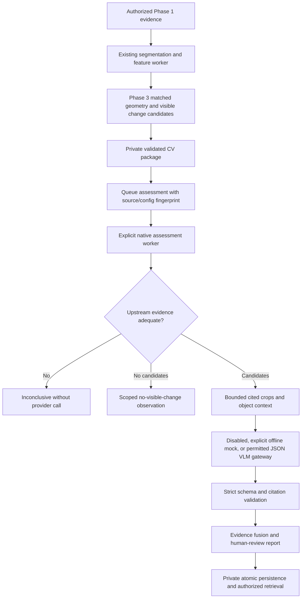

# Phase 3/4 implementation and operator contract

Gemini extension: [direct Google provider guide](gemini-provider.md). It reuses the
assessment schemas, citation checks and HTTPS limits below. Live Gemini calls remain
unverified and require separate authorization; the original JSON gateway is preserved.

Native Windows only, existing approved Conda interpreter. This milestone excludes
`test_images/` and all derived exploratory artifacts. Historical evaluation reports are
preserved, not used as current evidence. Development uses generated pixels and mocks.

## Architecture and compatibility

The existing Phase 2 implementation already contains alignment and candidate localization.
Phase 3 reuses these components: SIFT mutual matching, RANSAC, plausible homographies,
mask intersection, boundary erosion and masked SSIM. Thresholds remain unchanged.
New metadata distinguishes unattempted matching from an observed zero match count and
records alignment status and its overlap artifact. Controlled failures verified the fixes
for missing RANSAC masks and checking overlap after, rather than before, erosion.



`Orchestrator.run_cv` retains the first six protocols. `run_assessment` connects the
existing damage-verification, fusion and report protocols after a validated CV sub-result.
The original nine-stage `run` contract is preserved. There is no parallel alignment engine.
CV schema 2.0 has additive optional fields; assessment schema/pipeline is 4.0. Historical
CV results without explicit alignment/overlap metadata can still be read, but Phase 4
abstains rather than assume their support. Reprocessing is for future permitted inputs.

The parent inspection remains `created` with analysis unavailable, preserving Phase 1's
completion guard. A CV or assessment job's `completed` state means its own validated
sub-result was saved. The assessment's analytical status may still be inconclusive or
partial. No AI state performs a financial action or proves physical identity.

## Phase 4 evidence and safeguards

Only comparable, quality-approved pairs with sufficient similarity, inliers, geometric
support and overlap reach the provider. Before/after crops retain source UUIDs and boxes;
object crops, candidate overlays and overlap images supply context. Attachments are
deduplicated by artifact UUID and independently checked against stored size/hash metadata.
Each prepared crop carries its normalized source box, frame UUID and resized dimensions.
Only selected source hashes, quality, segmentation and pair metadata enter the request.
Every provider observation must cite an actual selected candidate, both source images and
the corresponding attached crops. Missing, invented, contradictory or unrelated citations
produce an inconclusive report with no accepted findings. Result reads repeat source and
citation validation. A VLM cannot override deterministic rejection or enlarge its scope.

Limits: four pairs, eight candidates, sixteen images, maximum image side 768 (default 512),
one MB per prepared PNG, eight MB total image bytes and one MB provider-response bytes.
Selection limits leave explicit unassessed candidate IDs and partial outcomes. Missing
context blocks inference instead of sending aggressively isolated crops. Unknown hands,
occlusion, reflective surfaces and mask leakage remain limitations; no universal cleanup
rule or new calibration was introduced. Known occluded regions in controlled tests are
excluded through masks. Unseen surfaces remain unsupported.

Provider observations support possible visible damage, no visible change in a cited region,
visual artifacts and insufficient evidence. Types and explanations are advisory, always
uncertain about physical causation and subject to human review. There is no calibrated
probability, repair-cost field or deposit decision. Image text is untrusted input, not an
instruction or tool authority. Mocked reports are explicitly marked and never called genuine
VLM inference. A no-candidate outcome is scoped to compared visible surfaces, not no damage.

## API and native worker

| Route | Behavior |
| --- | --- |
| POST `/v1/cv-runs/{run_id}/assessments` | Enqueue from a completed authorized CV sub-result; 202 |
| GET `/v1/assessments/{id}` | Authorized job state |
| POST `/v1/assessments/{id}/cancel` | Requester only; queued/processing states |
| GET `/v1/assessments/{id}/result` | Validated assessment; 409 until available |

Body example: `{ "allow_external": false, "max_candidates": 4, "max_pairs": 4, "image_side": 512 }`.
HTTP routes do not run GPU or VLM inference. Rentals control reads; the requesting subject
controls execution/cancellation. Original and normalized hashes, source state and all CV
artifacts are checked before and after assessment. Public responses omit private paths,
credentials and image bytes, and inherit `no-store` and request IDs.

Reports/jobs use a separate `<EP_DATA_DIR>/assessments/assessments.sqlite3` database. SQLite
transactions atomically save results. A four-job queue and the native worker/recovery lock
bound local concurrency. Restart fails interrupted work explicitly. Duplicate requests with
the same subject, CV fingerprint, options and provider configuration reuse the existing job,
including completed results. This avoids repeated VLM calls and reuses persisted CV results
without recalculating embeddings or keeping large models resident. Changing provider
configuration between queue and execution fails safely. Cancellation prevents commit even
if a bounded in-flight provider attempt finishes. There is no production scheduler or
distributed exactly-once guarantee.

Use native PowerShell from `ep/` with the same EP data/grants as the local API:

```powershell
$epPython = 'D:\Anaconda_Install\envs\neighbourlend_yolo\python.exe'
$env:EP_VLM_PROVIDER = 'mock' # Explicit offline fixture, not genuine VLM inference.
# Set EP_WORKER_TOKEN privately to the requesting subject's existing local token.
& $epPython -B scripts/run_assessment_worker.py '<queued-assessment-uuid>'
```

Configure the provider before creating the job. No credentials or token go in CLI arguments.
`disabled` is the default and produces an honest unavailable/inconclusive report.

## Optional external gateway contract — not live-verified

There was no existing EP VLM provider. `JSONHTTPProvider` implements an explicit reusable
HTTPS JSON gateway contract without adding a vendor SDK or guessing a model/key. A real
gateway must accept this protocol; this is not a claim of direct vendor API compatibility.
No live endpoint or external image transmission was used during this milestone.

Environment configuration: `EP_VLM_PROVIDER=json_http`, `EP_VLM_ENDPOINT`, `EP_VLM_MODEL`,
`EP_VLM_API_KEY`, and `EP_VLM_ALLOW_EXTERNAL=1`. The queued request must independently set
`allow_external=true`. Both opt-ins and a configured credential are required. Endpoint URL
credentials/query strings are rejected, redirects/proxy inheritance disabled and TLS
validation retained. `EP_VLM_TIMEOUT_SECONDS` defaults to 15 (maximum 30) and
`EP_VLM_MAX_RETRIES` to 1 (maximum 2). Only transient errors retry. Responses are bounded
and compressed responses are refused. HTTP connect/read/write/pool timeouts and streamed
elapsed checks apply; this is not an isolated hard-kill provider subprocess. Local worker
shutdown can require waiting for the bounded request timeout.

Requests include model, instruction, strict response schema, evidence manifest, base64 PNG
attachments with UUID/source/hash/dimension metadata and a maximum output-token request.
Responses use `{ "assessment": { "observations": [...], "limitations": [...] }, "usage":
{ "input_tokens": 123, "output_tokens": 45 } }`. Required observation fields are
`candidate_id`, `status`, `affected_region`, `evidence_ids`, `artifact_ids`, `explanation`,
`uncertainty`, with optional constrained `damage_type`. Extra claim/financial fields fail.
The full schema is `ProviderReply.model_json_schema()` and travels with the request.

Usage is null when unreported. An estimated USD cost is computed only if token usage and
explicit `EP_VLM_INPUT_USD_PER_MILLION` / `EP_VLM_OUTPUT_USD_PER_MILLION` rates exist. It is
not a bill or measured charge. HTTP attempts are recorded separately from evidence and
cannot be interpreted as successful or billable model inference.

HTTPX was already installed; the optional `assessment` dependency declaration documents
that requirement. No environment packages changed. Model weights and thresholds are unchanged.

## Verification and remaining work

See the companion Phase 3/4 report for executed tests/coverage and current measurements.
`docs/development-handoff.md` records where to resume. Run verification with
`scripts/verify.py <category> --synthetic-only`: excluded paths are denied by a pytest audit
hook and the child CV worker policy. The existing two bundled-photograph tests are explicitly
skipped; new native pretrained tests use generated pixels on CUDA and CPU. No old image
artifacts or reports supply validation data, and no image-dependent evaluation script runs.

Real VLM compatibility, calibrated damage performance, physical identity, representative
mask/occlusion robustness and production operations remain unverified. A later separate
milestone needs newly collected, consented, verified before/after objects with independent
annotations and fixed splits. Production auth, ACLs, retention, human dispute review and
full-inspection completion semantics still require reviewed integration. No frontend,
backend, payment or settlement component was changed.
