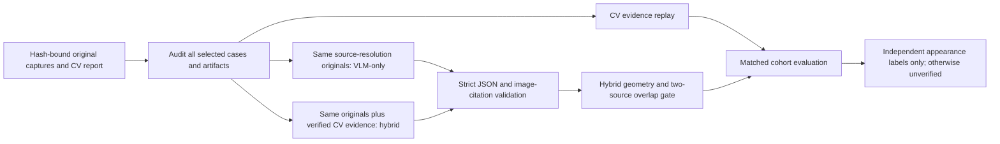

# Standalone EP v3.1 VLM evaluation harness

This harness compares **CV-only**, **VLM-only**, and **hybrid** appearance observations.
It reads EP input manifests and immutable CV reports; it does not change the CV
architecture, application, databases, payments, or Git state. Results remain private
JSON files. See [the measured report](vlm-evaluation-report.md) for executed runs.

The [optional OpenRouter wrapper](openrouter-v31.md) adds fresh standalone inspection,
explicit environment configuration and a separate conservative evidence-fusion report.
Its [verification report](openrouter-v31-report.md) distinguishes mocked success from
live provider availability. The existing CV entry point remains unchanged.



## Three comparison arms

* `cv_only` replays verified v3.1 candidates, boundary observations and original-tile
  regions on supported comparable pairs. No absence-of-damage inference is made.
  This is evidence replay, not a newly timed neural CV run.
* `vlm_only` receives original source-resolution, orientation-corrected RGB images,
  before/after identifiers and matching operator view labels. It receives no CV
  predictions, case/category filenames, labels, reviewer identifiers or local paths.
* `hybrid` receives the identical original pixels plus verified comparable/rejected
  CV pair metadata, candidates and bounded attached overlap/crop evidence. Its
  positives must cite valid source frames and regions entirely inside supported
  overlap in both captures, with intersecting projected regions. CV bidirectional
  error and spatial support gates are retained. Unsupported geometry abstains.
  A negative VLM reply cannot erase positive CV evidence or inconclusive coverage.

The VLM's normalized boxes refer to orientation-corrected original sources, not
the attached processing crops. Image citations and box validity are checked by
code; their presence does not independently verify the model's visual description.
Reflection, shadows, pose and registration remain alternatives. Findings are
unverified appearance hypotheses; physical identity is always false, human review
is always required, and `payment_action` is always `none`. Extra fields and nonfinite
values are rejected. Model image text is untrusted data, and no tools are exposed.

## Data and independent labels

The strict `Benchmark` schema has one `Case` per experiment, with hashes of its EP
input manifest and CV report, an object/session group, provenance, split, and kind.
Paths stay inside EP and symlink/junction escapes are rejected. Every report source
hash/dimension and every cited artifact hash, byte size and PNG dimensions are
verified against source-resolution inputs before inference. The whole selected
cohort is audited for object-group and duplicate-pixel split leakage before any
external call. Labels never enter prompts or cache fingerprints.

An optional label must have status `independently_reviewed`, task
`visible_appearance_change`, a strict boolean `change_present`, reviewer, annotation
version and a documented independent basis. This metadata records a claim of review;
software cannot prove annotator independence. Do not use CV/VLM outputs as truth.
Keep generated software controls in the `software_control` split and physical
captures in their reviewed development/calibration/test partitions.

For genuinely reviewed labels, the harness reports TP/FP/TN/FN, precision, recall,
F1 and false-positive rate on assessed examples, alongside label count, assessed
count and abstention. A recall lower bound includes positive-label abstentions.
Missing truth is excluded; missing/model-refused predictions abstain. Metrics are
separate per split. Only case IDs completed in all three modes enter the reported
paired-completion cohort. Offline fixtures are excluded from model accuracy metrics.

There are currently no independent condition labels in the prepared 56-case
collection. Exact repeats and different-category controls are separately identified
engineering checks. They are not independent damage labels or matched unchanged
recaptures. Damage accuracy, localization accuracy and physical identity accuracy
remain unverified. No training, threshold tuning or new holdout claim is made.

## Privacy, free-tier operation and limits

External calls are disabled by default. They require an explicit Gemini model,
`allow_external=true`, and `GEMINI_API_KEY`. The default `free_only=true` additionally
requires `free_tier_confirmed=true`, zero input/output rates and `max_cost_usd=0`.
The operator must first confirm that the API key's project has billing disabled.
This cannot be established by inspecting an API key; zero local accounting alone
cannot disable billing on a paid project. There is no paid fallback, automatic
upgrade, retry, file-upload service, remote image URL, or model download.

Google documents that free service depends on project billing status, and that
unpaid-service inputs/outputs may be used for product improvement. Use only photos
approved for that processing, without confidential/personal data. Removing metadata
does not remove sensitive visual background content. Sources:
[billing](https://ai.google.dev/gemini-api/docs/billing),
[unpaid-service data terms](https://ai.google.dev/gemini-api/terms),
[pricing](https://ai.google.dev/gemini-api/docs/pricing).

Original pixels are re-encoded as PNG without EXIF/GPS/text metadata and sent inline
only to `generativelanguage.googleapis.com` using verified HTTPS. No image resizing
silently reduces the original-image arm: over-budget collections are marked not run.
Proxies and redirects are disabled. Secrets stay in process environment/header values;
they do not enter prompts, cache files, public reports or raw provider-error logs.
The optional `--key-env` reads only `GEMINI_API_KEY` from an explicitly named local
file; it does not execute dotenv syntax or import application configuration.

Default bounds are 56 cases (maximum 200), six generation attempts, 20,000 input
tokens, 2,048 output tokens, eight images and eight MB of encoded image bytes per
request. The provider first counts the complete request's tokens. A child process
enforces an absolute count-plus-generation deadline; the default is 25 seconds.
Generation is never retried. At most two HTTP operations occur per reserved attempt
(token count then generation). Responses are capped at 256 KiB and must contain one
untruncated JSON candidate. Thinking tokens are included in reported output usage.
See [token counting](https://ai.google.dev/api/tokens) and
[structured output](https://ai.google.dev/gemini-api/docs/structured-output).

The run deadline stops admission of new API requests; local evidence audit/replay
still finishes within the configured finite case/file/pixel limits. Report its wall
time separately from provider latency. All results have conservative uncertainty.

`budget.jsonl` is the authoritative append-only reservation ledger. It is fsynced
before any potentially billable request; failures, refusals and timeouts never refund
reserved requests or dollars. Budget snapshots and results are lock-protected
diagnostic JSON, not transaction/financial records. Windows snapshots use in-place
writes to avoid DELETE-sharing failures. Partial snapshots/cache entries fail
validation; a torn ledger fails closed. A stale `run.lock` after process termination
also fails closed and requires operator inspection rather than automatic recovery.

Caches bind prompt/schema version, mode, provider/model, output cap, source pixels,
attached evidence, CV hash for hybrid and a credential-scope digest. Entries contain
only validated structured replies and usage, never original image bytes or keys.
Cache hits revalidate schema, citations, geometry and content digests. They consume
no extra request reservation. Identical config/manifest resumes retain the same
budget; a new directory defines a new operator-controlled campaign budget.
Caches are private local data, not tamper-proof storage against a trusted local user.

## Execution

From `ep/`, using the existing approved interpreter:

```powershell
$epPython = 'D:\Anaconda_Install\envs\neighbourlend_yolo\python.exe'
$env:PYTHONPATH = '.runtime/v3-packages;.'
& $epPython -B scripts/evaluate_vlm.py prepare-current .test-artifacts/vlm-evaluation-20261111/manifest.json
& $epPython -B scripts/evaluate_vlm.py run .test-artifacts/vlm-evaluation-20261111/manifest.json --config .test-artifacts/vlm-evaluation-20261111/disabled-config.json --output .test-artifacts/vlm-evaluation-20261111/disabled-final
```

For a free live run, copy [the example configuration](vlm-evaluation-live-config.example.json)
to an EP-private file. Select a currently available free-tier model and verify the
project's billing-disabled state and photo processing permission before setting the
confirmation flag. Keep the dollar budget and token rates at zero. The explicit
key-file option below reads the locally configured key without editing that file:

```powershell
& $epPython -B scripts/evaluate_vlm.py run .test-artifacts/vlm-evaluation-20261111/pilot-manifest.json --config .test-artifacts/vlm-evaluation-20261111/pilot-config.json --output .test-artifacts/vlm-evaluation-20261111/live-free-pilot --key-env ../backend/.env
```

Outputs include strict schemas, manifest/config receipts, per-mode JSON records,
token usage, cost estimates, cache state, reservations and the matched-cohort summary.
Do not serve output/cache directories publicly. Region-level accuracy, uncertainty
calibration, object-group confidence intervals and pre-registered integration
acceptance thresholds require a future independently labeled study. Integration is
not justified by API success, an exact-repeat check, or unlabeled observations.
